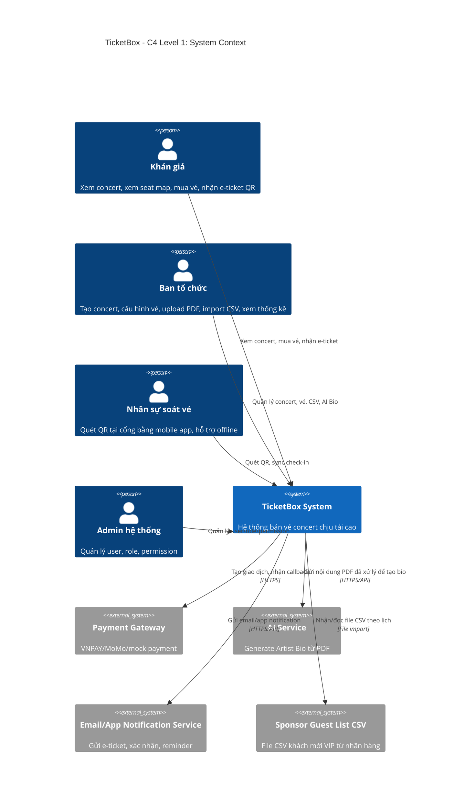
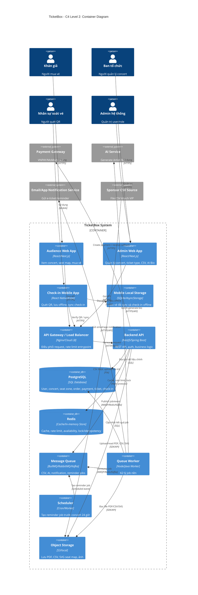

# 02 - C4 Diagram TicketBox

## 1. Mục tiêu

C4 Diagram dùng để mô tả hệ thống theo nhiều mức độ. Với phần việc của A, cần làm ít nhất:

- **C4 Level 1 - System Context:** TicketBox nằm trong bức tranh tổng thể, ai dùng hệ thống, hệ thống ngoài nào được tích hợp.
- **C4 Level 2 - Container:** TicketBox được phân rã thành các container chính như web app, mobile app, backend API, database, Redis, queue, worker, object storage.

---

## 2. C4 Level 1 - System Context

### 2.1. Actor và external system

| Đối tượng | Loại | Vai trò |
|---|---|---|
| Khán giả | Person | Xem concert, xem seat map, mua vé, nhận QR, check-in. |
| Ban tổ chức | Person | Tạo concert, cấu hình vé, upload PDF, import CSV, xem thống kê. |
| Nhân sự soát vé | Person | Dùng mobile app quét QR online/offline. |
| Admin hệ thống | Person | Quản lý user, role, permission. |
| Payment Gateway | External System | VNPAY/MoMo xử lý thanh toán. |
| AI Service | External System | Tạo Artist Bio từ nội dung PDF. |
| Email/App Notification Service | External System | Gửi xác nhận, e-ticket, reminder 24h. |
| Sponsor Guest List CSV | External Source | File CSV khách VIP từ nhãn hàng. |

### 2.2. Mermaid C4 Context

---

## 3. C4 Level 2 - Container Diagram

### 3.1. Container chính

| Container | Công nghệ đề xuất | Vai trò |
|---|---|---|
| Audience Web App | React/Next.js | Xem concert, seat map, mua vé, xem e-ticket. |
| Admin Web App | React/Next.js | Quản lý concert, vé, PDF, CSV, dashboard. |
| Check-in Mobile App | React Native/Expo | Quét QR, offline storage, sync check-in. |
| API Gateway/Load Balancer | Nginx/Cloud LB/API Gateway | Điều phối request, hỗ trợ rate limiting. |
| Backend API | NestJS/Spring Boot | REST API, auth, business logic, orchestration. |
| PostgreSQL | SQL Database | Source of truth cho dữ liệu chính. |
| Redis | In-memory Store | Cache, rate limit, availability cache, lock/idempotency hỗ trợ. |
| Message Queue | BullMQ/RabbitMQ/Kafka | Lưu job/event bất đồng bộ. |
| Queue Worker | Node/Java Worker | Xử lý CSV, AI, notification, reminder. |
| Object Storage | S3/local storage | Lưu PDF, CSV, SVG seat map, ảnh. |
| Scheduler | Cron/Worker Scheduler | Tạo reminder job trước concert 24 giờ. |

### 3.2. Mermaid C4 Container

---

## 4. Giải thích thiết kế C4

### 4.1. Vì sao tách 3 client?

| Client | Lý do tách |
|---|---|
| Audience Web App | Tối ưu trải nghiệm đọc concert, seat map và checkout. |
| Admin Web App | Chức năng nội bộ, cần RBAC chặt và dashboard quản trị. |
| Check-in Mobile App | Cần camera, local storage, offline sync tại cổng sự kiện. |

### 4.2. Vì sao Backend API là trung tâm?

Backend API kiểm soát auth, RBAC, business rules, order, payment, ticket, check-in, CSV, AI. Client không được gọi trực tiếp database/payment/AI để tránh mất an toàn và mất consistency.

### 4.3. Vì sao có API Gateway/Load Balancer?

TicketBox có tải đột biến khi mở bán. API Gateway/Load Balancer giúp:

- Điều phối traffic vào nhiều instance backend.
- Là điểm đặt rate limiting/throttling.
- Có thể mở rộng thành waiting room trong tương lai.

### 4.4. Vì sao có Object Storage?

Object Storage dùng để lưu các file lớn/ít cấu trúc:

- PDF press kit của nghệ sĩ.
- CSV khách VIP.
- SVG seat map.
- Ảnh concert/nghệ sĩ.

Metadata vẫn lưu trong PostgreSQL để query và kiểm soát quyền.

### 4.5. Vì sao có Scheduler?

Yêu cầu gửi reminder trước concert 24 giờ không xuất phát từ request của user. Scheduler tạo reminder job theo thời gian, sau đó Notification Worker xử lý gửi email/app notification.

---

## 5. Checklist C4

- [ ] C4 Level 1 có đủ actor: Khán giả, Ban tổ chức, Nhân sự soát vé, Admin hệ thống.
- [ ] C4 Level 1 có external systems: Payment, AI, Notification, CSV.
- [ ] C4 Level 2 có Audience Web, Admin Web, Mobile App.
- [ ] C4 Level 2 có API Gateway/Load Balancer.
- [ ] C4 Level 2 có Backend API, PostgreSQL, Redis, Queue, Worker, Scheduler, Object Storage.
- [ ] Có Mobile Local Storage cho offline check-in.
- [ ] Có Object Storage cho PDF, CSV, SVG seat map.
- [ ] Có Scheduler/Notification Worker cho reminder 24 giờ.
- [ ] Container khớp với High-Level Architecture.
