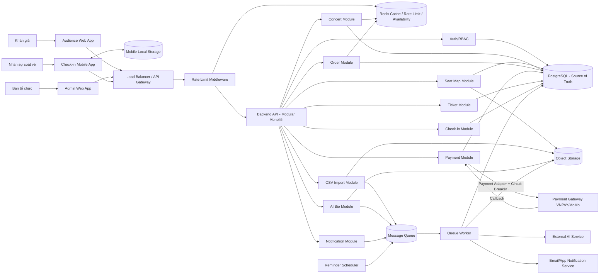

# 03 - High-Level Architecture Diagram TicketBox

## 1. Mục tiêu

High-Level Architecture Diagram mô tả luồng dữ liệu và sự phụ thuộc giữa các thành phần chính. Sơ đồ cần làm rõ các điểm quan trọng của TicketBox:

- Xem concert, seat map SVG và số vé còn lại.
- Mua vé, payment và phát hành e-ticket QR.
- Cache để giảm tải trang danh sách/chi tiết concert.
- Rate limiting và fairness khi mở bán.
- Payment Gateway lỗi nhưng hệ thống vẫn hoạt động phần không liên quan payment.
- AI Artist Bio từ PDF.
- CSV Import khách VIP.
- Offline check-in và sync lại.
- Reminder trước concert 24 giờ.

---

## 2. High-Level Architecture Diagram



---

## 3. Luồng xem concert, seat map và availability

```text
Audience Web
→ API Gateway / Rate Limit
→ Backend API
→ Concert Module / Seat Map Module
→ Redis Cache
→ PostgreSQL nếu cache miss
→ Object Storage nếu cần tải SVG
```

Thiết kế:

- Concert list/detail là dữ liệu đọc nhiều, ít thay đổi, nên cache bằng Redis.
- SVG seat map lưu ở Object Storage, metadata khu ngồi lưu PostgreSQL.
- Availability theo khu như GA/SVIP/VIP/CAT1/CAT2 có thể cache ngắn hạn.
- Redis chỉ cung cấp dữ liệu gần đúng cho hiển thị; PostgreSQL vẫn là source of truth khi checkout.

TTL đề xuất:

| Dữ liệu | TTL đề xuất | Ghi chú |
|---|---:|---|
| Concert list | 60-120 giây | Dữ liệu ít thay đổi. |
| Concert detail | 60-120 giây | Invalidate khi admin cập nhật. |
| Seat map metadata | 5-10 phút | Chỉ đổi khi admin sửa sơ đồ. |
| Availability theo khu | 3-10 giây | Thay đổi nhanh, cần TTL ngắn hoặc invalidate khi payment success. |

---

## 4. Luồng mua vé và thanh toán

```text
Audience Web
→ Backend API
→ Order Module
→ PostgreSQL transaction / lock ticket_type
→ Payment Module
→ Payment Gateway
→ Payment callback
→ Ticket Module
→ Notification Queue
→ Email/App Notification Worker
```

Thiết kế:

- Khi user tạo order, backend kiểm tra ticket availability và per-user limit trong transaction.
- Có thể dùng row-level lock trên `ticket_types` hoặc optimistic locking với version.
- Chỉ khi payment thành công, Ticket Module mới phát hành QR e-ticket.
- Callback payment phải idempotent để tránh phát hành vé hai lần.
- Notification gửi qua queue để không làm chậm checkout.

Nguyên tắc quan trọng:

> **PostgreSQL là source of truth. Redis chỉ hỗ trợ cache/rate limit/lock/idempotency, không quyết định cuối cùng việc còn vé hay không.**

---

## 5. Luồng fairness và chống bot khi mở bán

```text
Client
→ API Gateway
→ Rate Limit Middleware
→ Redis counter theo IP/user/device/endpoint
→ Backend API nếu còn quota
```

Cơ chế thiết kế:

| Cơ chế | Mục đích |
|---|---|
| Rate limiting theo IP | Giảm spam từ cùng một nguồn. |
| Rate limiting theo user | Chặn một tài khoản gửi quá nhiều request checkout/payment. |
| Rate limiting theo endpoint | Endpoint nhạy cảm như `POST /orders` có limit thấp hơn `GET /concerts`. |
| Per-user ticket limit | Không cho một tài khoản mua vượt số vé đã cấu hình. |
| Idempotency key | Request thanh toán lặp không tạo giao dịch mới. |
| Waiting room/queue mở rộng | Có thể bổ sung nếu cần điều tiết request khi 80.000 người truy cập cùng lúc. |

---

## 6. Luồng Payment Gateway lỗi

```text
Payment Module
→ Payment Adapter
→ Circuit Breaker
→ Payment Gateway
```

Thiết kế:

- Payment Gateway được gọi qua Payment Adapter, không gọi trực tiếp từ Order Module.
- Circuit Breaker có 3 trạng thái: Closed, Open, Half-Open.
- Khi gateway lỗi kéo dài, hệ thống tạm ngưng tạo payment mới hoặc hiển thị thử lại sau.
- Các chức năng không phụ thuộc payment như xem concert, xem seat map, xem availability vẫn hoạt động.

Graceful degradation:

| Thành phần | Khi payment lỗi kéo dài |
|---|---|
| Xem concert | Vẫn hoạt động. |
| Xem seat map | Vẫn hoạt động. |
| Tạo order/payment | Có thể tạm khóa hoặc đưa vào trạng thái chờ. |
| AI Bio/CSV/Admin | Không bị ảnh hưởng trực tiếp. |
| Check-in | Không bị ảnh hưởng nếu event/ticket đã phát hành trước đó. |

---

## 7. Luồng AI Artist Bio

```text
Admin Web
→ Backend API
→ Object Storage lưu PDF
→ Queue tạo AI job
→ Worker extract/clean text
→ AI Service
→ PostgreSQL lưu Artist Bio draft
→ Admin review/publish
```

Thiết kế:

- Không gọi AI Service trực tiếp trong request upload PDF vì AI có thể chậm.
- Worker xử lý extract text, clean text và gọi AI.
- Kết quả AI nên ở trạng thái `DRAFT` để ban tổ chức duyệt trước khi publish.
- Nếu AI lỗi, admin có thể retry hoặc nhập bio thủ công.

---

## 8. Luồng CSV Import khách VIP

```text
Admin Web
→ Backend API upload CSV
→ Object Storage lưu file
→ Queue tạo import job
→ CSV Worker validate từng dòng
→ PostgreSQL lưu vip_guests hợp lệ
→ Admin xem import result
```

Thiết kế:

- CSV là tích hợp một chiều, không có API từ nhãn hàng.
- Import xử lý async để không làm gián đoạn hệ thống bán vé.
- Worker cần validate từng dòng, ghi nhận dòng lỗi, xử lý dữ liệu trùng.
- Kết quả import nên lưu lại để admin xem được số dòng thành công/thất bại.

---

## 9. Luồng soát vé offline và sync lại

```text
Mobile App sync dữ liệu trước sự kiện
→ Lưu vào Mobile Local Storage
→ Mất mạng
→ Scan QR offline
→ Ghi local check-in log
→ Có mạng lại
→ Sync API
→ Backend xử lý conflict
→ PostgreSQL cập nhật kết quả cuối cùng
```

Thiết kế:

- Mobile App phải sync danh sách vé/guest hợp lệ trước sự kiện.
- Khi offline, app xác nhận tạm thời dựa trên local data.
- Server vẫn là nơi quyết định cuối cùng khi sync.
- Nếu một vé đã check-in ở thiết bị khác, backend reject log sync sau.

Conflict handling:

| Tình huống | Cách xử lý |
|---|---|
| Vé đã check-in ở thiết bị khác | Server reject log đến sau, ghi conflict. |
| QR không có trong local cache | App đánh dấu cần verify khi online. |
| Dữ liệu local quá cũ | App cảnh báo cần sync lại. |
| Quét lại trên cùng thiết bị | App chặn bằng local log. |

---

## 10. Luồng notification và reminder 24 giờ

### 10.1. Sau khi mua vé thành công

```text
Payment success
→ Ticket Module phát hành QR
→ Notification Module publish job
→ Notification Worker
→ Email/App Notification Service
→ Khán giả nhận e-ticket
```

### 10.2. Reminder trước concert 24 giờ

```text
Reminder Scheduler
→ Tìm concert sắp diễn ra sau 24 giờ
→ Publish reminder jobs
→ Notification Worker
→ Email/App Notification Service
```

Thiết kế:

- Reminder là tác vụ nền, không liên quan request chính.
- Notification provider được thiết kế theo adapter để dễ thêm Zalo OA/SMS sau này.

---

## 11. Điểm scale ngang

| Thành phần | Có thể scale ngang? | Ghi chú |
|---|---|---|
| Audience Web App | Có | Stateless, có thể đặt sau CDN. |
| Admin Web App | Có | Tải thấp hơn Audience Web. |
| Backend API | Có | Stateless, dùng JWT/session ngoài memory local. |
| Queue Worker | Có | Tăng số worker để xử lý CSV/AI/notification. |
| Redis | Có điều kiện | Dùng managed Redis/cluster nếu cần. |
| PostgreSQL | Có giới hạn | Scale đọc bằng replica, ghi vẫn phải kiểm soát transaction. |
| Object Storage | Có | Phù hợp lưu file lớn. |

---

## 12. Checklist Mục 3

- [ ] Có đủ Web Audience, Admin Web, Mobile App.
- [ ] Có API Gateway/Load Balancer và Rate Limit Middleware.
- [ ] Có Backend API, PostgreSQL, Redis, Queue, Worker, Scheduler, Object Storage.
- [ ] Có Payment Gateway, AI Service, Email/App Notification Service.
- [ ] Có luồng xem concert + cache.
- [ ] Có luồng seat map SVG + availability theo khu.
- [ ] Có luồng mua vé + transaction + payment + ticket QR.
- [ ] Có luồng fairness/chống bot.
- [ ] Có luồng payment lỗi + circuit breaker.
- [ ] Có luồng AI Bio qua queue.
- [ ] Có luồng CSV Import qua queue.
- [ ] Có luồng offline check-in và sync.
- [ ] Có luồng reminder 24 giờ.
- [ ] Có nhấn mạnh PostgreSQL là source of truth, Redis chỉ hỗ trợ.
