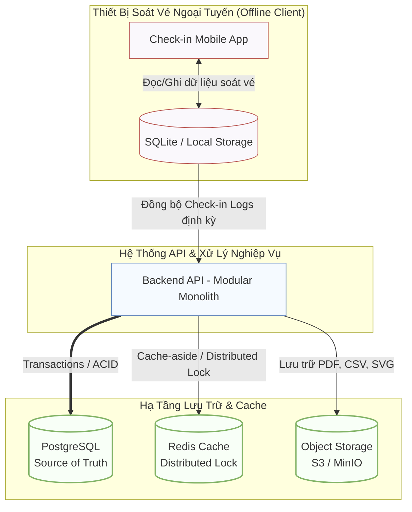
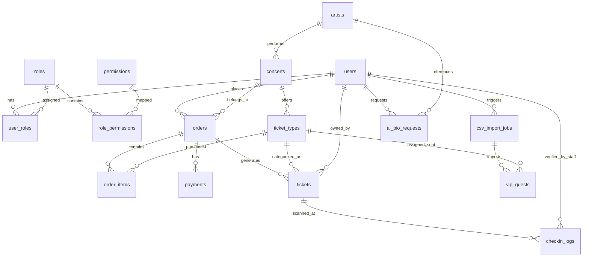
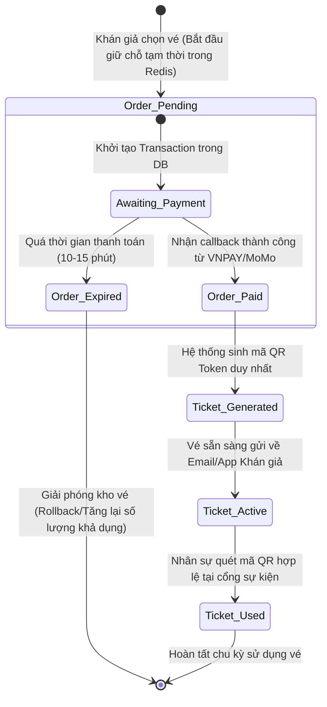
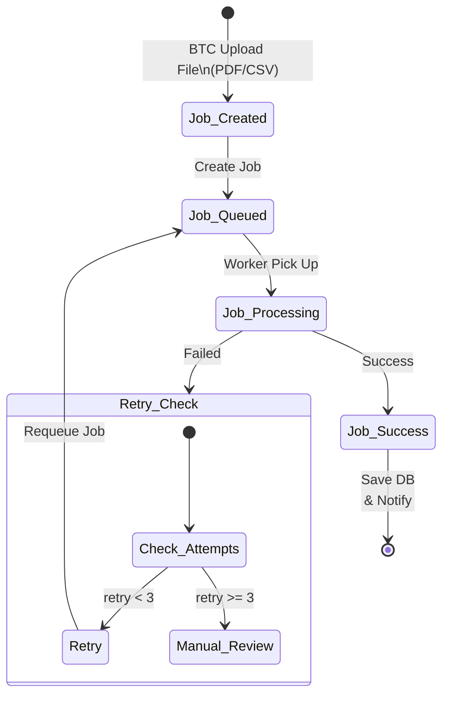

# 04 - Thiết Kế Cơ Sở Dữ Liệu & Mô Hình Lưu Trữ (TicketBox Blueprint)

Tài liệu này trình bày chi tiết về kiến trúc lưu trữ dữ liệu, mô hình quan hệ thực thể (ERD) và vòng đời của các thực thể cốt lõi trong hệ thống TicketBox. Hệ thống áp dụng nguyên tắc **Single Source of Truth (PostgreSQL)** kết hợp các giải pháp lưu trữ bổ trợ hiệu năng cao.

---

## 1. Kiến Trúc Phân Lớp Lưu Trữ (Data Storage Architecture)

Hệ thống phân rã dữ liệu thành các kho lưu trữ chuyên biệt tùy thuộc vào đặc tính kỹ thuật và workload của từng module nghiệp vụ:

* **PostgreSQL:** Đóng vai trò là trung tâm dữ liệu ACID, chịu trách nhiệm lưu trữ các giao dịch tài chính, thông tin phân quyền RBAC, dữ liệu vé và thông tin người dùng.
* **Redis:** Dùng cho Cache-aside (giảm tải đọc concert), Rate Limiting (chống bot), quản lý session và Distributed Lock ở tầng ứng dụng nhằm giảm tranh chấp tài nguyên. Redis không lưu dữ liệu quyết định (ví dụ: sold_quantity); tính nhất quán của luồng mua vé vẫn được đảm bảo bởi transaction và row-level lock trong PostgreSQL.
* **Object Storage (MinIO/S3):** Lưu trữ các tệp tin phi cấu trúc có dung lượng lớn như file SVG sơ đồ ghế (Seat map), file CSV danh sách khách VIP và file PDF Press Kit của nghệ sĩ.
* **Mobile Local Storage (SQLite):** Cơ sở dữ liệu nhúng tại thiết bị của nhân sự soát vé, phục vụ lưu kho vé offline và ghi nhận log check-in cục bộ trước khi đồng bộ.

---

## 2. Sơ Đồ Quan Hệ Thực Thể (Entity Relationship Diagram - ERD)

Dưới đây là sơ đồ ERD tổng thể của hệ thống, được phân bổ theo cấu trúc module hóa (Modular Monolith) để tránh chồng chéo các kết nối đường truyền dữ liệu:

---

### Chi tiết các thực thể chính trong hệ thống:

* **`users`**: Lưu trữ hồ sơ định danh tài khoản người dùng hệ thống.
* **`roles` & `permissions`**: Quản lý ma trận phân quyền dựa trên vai trò (RBAC).
* **`ticket_types`**: Quản lý cấu hình kho vé, giá vé, số lượng tổng (`total_quantity`) và số lượng đã bán thực tế (`sold_quantity`) để thực hiện đối soát chống oversell.
* **`orders` & `payments`**: Đảm bảo tính toàn vẹn của giao dịch. `payments` lưu trữ mã `idempotency_key` nhằm loại bỏ hoàn toàn rủi ro double-payment.
* **`checkin_logs`**: Ghi nhận toàn bộ vết soát vé tại cổng, hỗ trợ hai chế độ kết nối (`online` / `offline`) phục vụ đối soát xung đột dữ liệu.

---

## 3. Vòng Đời Trạng Thái Dữ Liệu (Data Lifecycle Diagram)

Hiểu rõ sự biến đổi trạng thái của dữ liệu giúp hệ thống thiết kế chính xác các ràng buộc logic, đảm bảo tính nhất quán cao tại mọi thời điểm diễn ra nghiệp vụ.

### 3.1. Vòng đời của Đơn hàng & Vé (Order & Ticket Lifecycle)

Luồng thay đổi từ khi khán giả bắt đầu giữ chỗ trong hàng đợi cho đến khi vé được quét thành công tại cổng sự kiện:

### 3.2. Vòng đời của Tiến trình xử lý ngầm (Background Job Lifecycle)

Xử lý luồng dữ liệu bất đồng bộ khi Ban tổ chức thực hiện tải lên file CSV Khách VIP dung lượng lớn hoặc yêu cầu AI tóm tắt thông tin nghệ sĩ:

## 4. Các Ràng Buộc Bảo Mật Dữ Liệu Quan Trọng (Data Constraints Checklist)

Để bảo vệ tính toàn vẹn của dữ liệu trong các tình huống chịu tải cao, hệ thống kích hoạt các ràng buộc cứng ở lớp database:

*  **`tickets.qr_token` (UNIQUE):** Ngăn chặn tuyệt đối việc trùng lặp mã vé hoặc tạo vé giả mạo.
*  **`payments.idempotency_key` (UNIQUE):** Chống xử lý trùng giao dịch thanh toán khi người dùng nhấn nút F5 liên tục.
*  **`ticket_types.sold_quantity <= ticket_types.total_quantity` (CHECK):** Ràng buộc tầng cứng ngăn chặn hiện tượng bán vượt số lượng vé quy định (Oversell).
*  **`checkin_logs.ticket_id` & `checkin_logs.scanned_at` (COMPOSITE INDEX):** Tối ưu hóa tốc độ truy vấn kiểm tra trùng lặp lượt quét vé ở tốc độ mili-giây.
