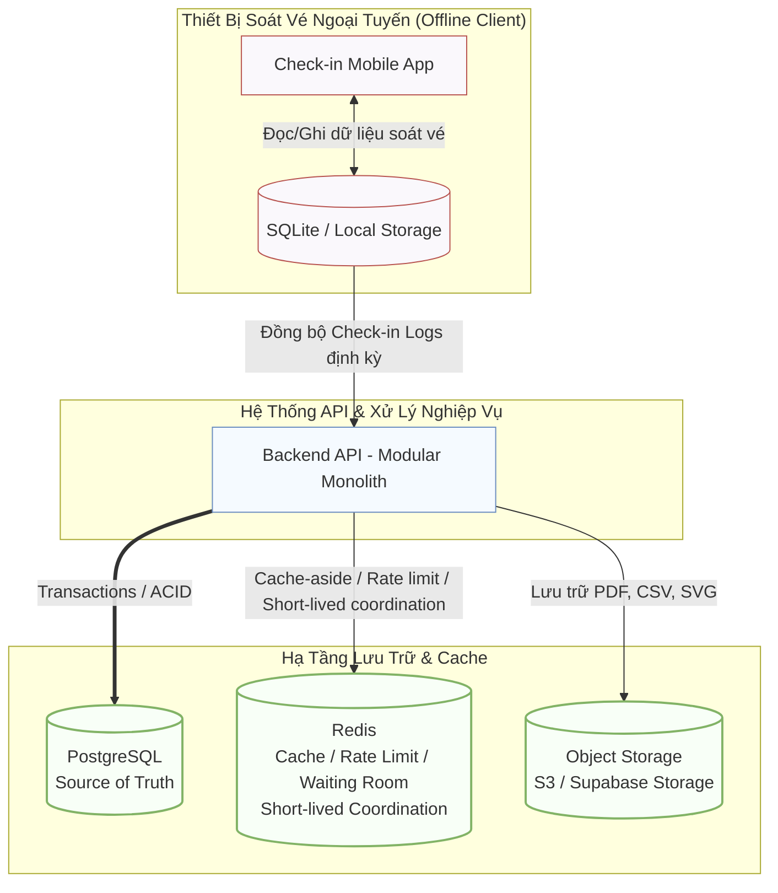
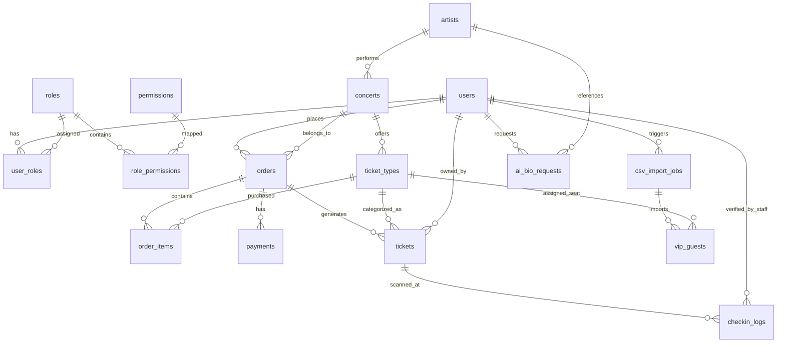
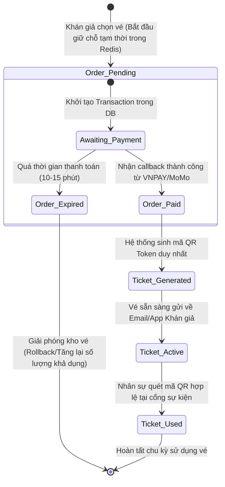
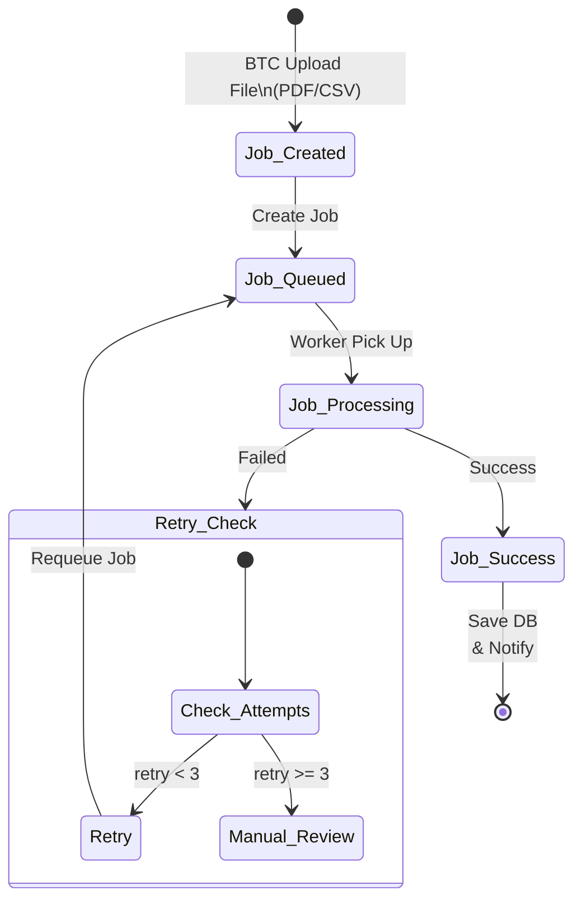

# 04 - Thiết Kế Cơ Sở Dữ Liệu & Mô Hình Lưu Trữ (TicketBox Blueprint)

Tài liệu này trình bày chi tiết về kiến trúc lưu trữ dữ liệu, mô hình quan hệ thực thể (ERD) và vòng đời của các thực thể cốt lõi trong hệ thống TicketBox. Hệ thống áp dụng nguyên tắc **Single Source of Truth (PostgreSQL)** kết hợp các giải pháp lưu trữ bổ trợ hiệu năng cao.

---

## 1. Kiến Trúc Phân Lớp Lưu Trữ (Data Storage Architecture)

Hệ thống phân rã dữ liệu thành các kho lưu trữ chuyên biệt tùy thuộc vào đặc tính kỹ thuật và workload của từng module nghiệp vụ:

* **PostgreSQL:** Đóng vai trò là trung tâm dữ liệu ACID, chịu trách nhiệm lưu trữ các giao dịch tài chính, thông tin phân quyền RBAC, dữ liệu vé và thông tin người dùng.
* **Redis:** Dùng cho Cache-aside (giảm tải đọc concert), Rate Limiting, waiting room, idempotency tạm thời và short-lived coordination ở tầng ứng dụng. Redis không lưu dữ liệu quyết định như `sold_quantity` và không quyết định cuối cùng việc còn vé hay không. Khi tạo order, Backend luôn kiểm tra lại tồn vé trong PostgreSQL transaction bằng pessimistic row-level lock trước khi commit.
* **Object Storage (Supabase Storage/S3):** Lưu trữ các tệp tin phi cấu trúc có dung lượng lớn như file SVG sơ đồ ghế (Seat map), file CSV danh sách khách VIP và file PDF Press Kit của nghệ sĩ.
* **Mobile Local Storage (SQLite):** Cơ sở dữ liệu nhúng tại thiết bị của nhân sự soát vé, phục vụ lưu kho vé offline và ghi nhận log check-in cục bộ trước khi đồng bộ.

---

## 2. Sơ Đồ Quan Hệ Thực Thể (Entity Relationship Diagram - ERD)

Dưới đây là sơ đồ ERD tổng thể của hệ thống, được phân bổ theo cấu trúc module hóa (Modular Monolith) để tránh chồng chéo các kết nối đường truyền dữ liệu:

---

### Chi tiết các thực thể chính trong hệ thống:

* **`users`**: Lưu trữ hồ sơ định danh tài khoản người dùng hệ thống.
* **`roles` & `permissions`**: Quản lý ma trận phân quyền dựa trên vai trò (RBAC).
* **`ticket_types`**: Quản lý cấu hình kho vé, giá vé, số lượng tổng (`total_quantity`) và số lượng đã bán thực tế (`sold_quantity`) để thực hiện đối soát chống oversell.
* **`orders` & `payments`**: Đảm bảo tính toàn vẹn của giao dịch. `payments` lưu trữ mã `idempotency_key` nhằm loại bỏ hoàn toàn rủi ro double-payment.
* **`checkin_logs`**: Ghi nhận toàn bộ vết soát vé tại cổng, hỗ trợ hai chế độ kết nối (`online` / `offline`) phục vụ đối soát xung đột dữ liệu.

---

## 3. Vòng Đời Trạng Thái Dữ Liệu (Data Lifecycle Diagram)

Hiểu rõ sự biến đổi trạng thái của dữ liệu giúp hệ thống thiết kế chính xác các ràng buộc logic, đảm bảo tính nhất quán cao tại mọi thời điểm diễn ra nghiệp vụ.

### 3.1. Vòng đời của Đơn hàng & Vé (Order & Ticket Lifecycle)

Luồng thay đổi từ khi khán giả bắt đầu giữ chỗ trong hàng đợi cho đến khi vé được quét thành công tại cổng sự kiện:

### 3.2. Vòng đời của Tiến trình xử lý ngầm (Background Job Lifecycle)

Xử lý luồng dữ liệu bất đồng bộ khi Ban tổ chức thực hiện tải lên file CSV Khách VIP dung lượng lớn hoặc yêu cầu AI tóm tắt thông tin nghệ sĩ:

## 4. Các Ràng Buộc Bảo Mật Dữ Liệu Quan Trọng (Data Constraints Checklist)

Để bảo vệ tính toàn vẹn của dữ liệu trong các tình huống chịu tải cao, hệ thống kích hoạt các ràng buộc cứng ở lớp database:

*  **`tickets.qr_token` (UNIQUE):** Ngăn tạo hai bản ghi vé có cùng QR token. Việc chống vé giả còn cần token khó đoán, chữ ký/xác thực QR và kiểm tra trạng thái vé tại Backend.
*  **`payments.idempotency_key` (UNIQUE):** Chống xử lý trùng giao dịch thanh toán khi người dùng nhấn nút F5 liên tục.
*  **`ticket_types.sold_quantity <= ticket_types.total_quantity` (CHECK):** Ràng buộc tầng cứng ngăn chặn hiện tượng bán vượt số lượng vé quy định (Oversell).
*  **`checkin_logs.ticket_id` & `checkin_logs.scanned_at` (COMPOSITE INDEX):** Tối ưu hóa tốc độ truy vấn kiểm tra trùng lặp lượt quét vé ở tốc độ mili-giây.

---

## 5. Schema Chi Tiết Các Bảng Chính (Table Schema Reference)

Schema bên dưới phản ánh trực tiếp từ TypeORM entity trong codebase. Mỗi bảng có đủ columns, types, constraints và indexes.

### 5.1. Bảng `users`

| Column | Type | Constraints | Ghi chú |
|---|---|---|---|
| `id` | UUID | PRIMARY KEY | Auto-generated UUID |
| `email` | VARCHAR(255) | NOT NULL, UNIQUE, INDEX | Định danh đăng nhập |
| `name` | VARCHAR(100) | NOT NULL | Tên hiển thị |
| `password_hash` | VARCHAR(255) | NOT NULL | bcrypt hash, không lưu plain text |
| `permission_version` | INTEGER | NOT NULL, DEFAULT 1 | Invalidate Redis permission cache khi RBAC thay đổi |
| `is_active` | BOOLEAN | NOT NULL, DEFAULT true | Soft-disable account |
| `created_at` | TIMESTAMPTZ | NOT NULL, AUTO | — |
| `updated_at` | TIMESTAMPTZ | NOT NULL, AUTO | — |
| `deleted_at` | TIMESTAMPTZ | NULLABLE | Soft delete |

**Lý do thiết kế:** `permission_version` là cơ chế trung tâm của RBAC — khi Admin đổi role/quyền, version tăng, Redis cache bị invalidate, request tiếp theo load lại từ DB.

---

### 5.2. Bảng `concerts`

| Column | Type | Constraints | Ghi chú |
|---|---|---|---|
| `id` | UUID | PRIMARY KEY | — |
| `name` | VARCHAR(300) | NOT NULL | Tên concert |
| `organizer_id` | UUID | NOT NULL | FK → users.id |
| `status` | ENUM | NOT NULL, INDEX, DEFAULT 'DRAFT' | DRAFT / PUBLISHED / CANCELLED / COMPLETED |
| `starts_at` | TIMESTAMPTZ | NOT NULL, INDEX | Thời điểm bắt đầu |
| `ends_at` | TIMESTAMPTZ | NOT NULL | Thời điểm kết thúc |
| `sale_starts_at` | TIMESTAMPTZ | NULLABLE | Mở bán từ |
| `sale_ends_at` | TIMESTAMPTZ | NULLABLE | Đóng bán lúc |
| `venue` | TEXT | NULLABLE | Địa điểm |
| `description` | TEXT | NULLABLE | Mô tả |
| `banner_object_key` | VARCHAR | NULLABLE | Key trong Object Storage (Supabase Storage/S3) |
| `created_at` | TIMESTAMPTZ | NOT NULL, AUTO | — |
| `updated_at` | TIMESTAMPTZ | NOT NULL, AUTO | — |

**Bảng trung gian:** `concert_artists (concert_id UUID, artist_id UUID)` — ManyToMany Concert-Artist.

---

### 5.3. Bảng `ticket_types` — Bảng Kho Vé (Critical)

| Column | Type | Constraints | Ghi chú |
|---|---|---|---|
| `id` | UUID | PRIMARY KEY | — |
| `concert_id` | UUID | NOT NULL, FK → concerts | — |
| `name` | VARCHAR(100) | NOT NULL | GA / SVIP / VIP / CAT1 / CAT2 |
| `price` | NUMERIC(15,2) | NOT NULL | Giá vé |
| `total_quantity` | INTEGER | NOT NULL, DEFAULT 0 | Tổng số vé phát hành |
| `sold_quantity` | INTEGER | NOT NULL, DEFAULT 0 | Đã bán (sau payment CONFIRMED) |
| `held_quantity` | INTEGER | NOT NULL, DEFAULT 0 | Đang giữ chờ thanh toán |
| `max_per_user` | INTEGER | NOT NULL, DEFAULT 4 | Giới hạn mua tối đa/user |
| `sale_starts_at` | TIMESTAMPTZ | NULLABLE | — |
| `sale_ends_at` | TIMESTAMPTZ | NULLABLE | — |
| `created_at` | TIMESTAMPTZ | NOT NULL, AUTO | — |
| `updated_at` | TIMESTAMPTZ | NOT NULL, AUTO | — |

**CHECK constraint (tầng DB):** `sold_quantity + held_quantity <= total_quantity` — ràng buộc cứng ngăn oversell tuyệt đối.

**Cơ chế chống oversell:** `SELECT ... FOR UPDATE` trong transaction ngắn → đọc lại tồn vé → tăng `held_quantity` → commit. Không giữ DB lock khi gọi Payment Gateway.

---

### 5.4. Bảng `orders`

| Column | Type | Constraints | Ghi chú |
|---|---|---|---|
| `id` | UUID | PRIMARY KEY | — |
| `user_id` | UUID | NOT NULL, INDEX | COMPOSITE INDEX (user_id, status) |
| `concert_id` | UUID | NOT NULL | — |
| `ticket_type_id` | UUID | NOT NULL | — |
| `quantity` | INTEGER | NOT NULL | Số vé trong order |
| `total_amount` | NUMERIC(15,2) | NOT NULL | Tổng tiền |
| `status` | ENUM | NOT NULL, DEFAULT 'PENDING_PAYMENT' | PENDING_PAYMENT / PAID / EXPIRED / CANCELLED |
| `expires_at` | TIMESTAMPTZ | NOT NULL | Hết hạn giữ vé (10 phút) — BullMQ delayed job kiểm tra |
| `created_at` | TIMESTAMPTZ | NOT NULL, AUTO | — |
| `updated_at` | TIMESTAMPTZ | NOT NULL, AUTO | — |

---

### 5.5. Bảng `payments`

| Column | Type | Constraints | Ghi chú |
|---|---|---|---|
| `id` | UUID | PRIMARY KEY | — |
| `order_id` | UUID | NOT NULL, INDEX | FK → orders |
| `idempotency_key` | VARCHAR | NOT NULL, **UNIQUE** | Chống double-payment: userId:orderId hoặc client-generated |
| `provider_tx_id` | VARCHAR | **UNIQUE**, NULLABLE | Provider transaction ID — ngăn xử lý callback 2 lần |
| `provider` | VARCHAR(50) | NOT NULL | 'VNPAY' or 'MOMO' |
| `amount` | NUMERIC(15,2) | NOT NULL | Số tiền giao dịch |
| `status` | ENUM | NOT NULL, DEFAULT 'PENDING' | PENDING / CONFIRMED / FAILED / REFUNDED |
| `raw_callback` | JSONB | NULLABLE | Toàn bộ payload callback từ Gateway để audit |
| `created_at` | TIMESTAMPTZ | NOT NULL, AUTO | — |
| `updated_at` | TIMESTAMPTZ | NOT NULL, AUTO | — |

**Consistency:** `idempotency_key UNIQUE` + `provider_tx_id UNIQUE` — hai lớp bảo vệ độc lập chống trừ tiền 2 lần.

---

### 5.6. Bảng `tickets`

| Column | Type | Constraints | Ghi chú |
|---|---|---|---|
| `id` | UUID | PRIMARY KEY | — |
| `order_id` | UUID | NOT NULL, INDEX, FK → orders | — |
| `ticket_type_id` | UUID | NOT NULL, FK → ticket_types | — |
| `user_id` | UUID | NOT NULL, INDEX | — |
| `concert_id` | UUID | NOT NULL | — |
| `qr_token` | VARCHAR | NOT NULL, **UNIQUE** | HMAC-signed opaque token — không chứa PII |
| `manual_code` | VARCHAR(12) | NOT NULL, UNIQUE, INDEX | Mã soát thủ công khi camera không đọc QR |
| `status` | ENUM | NOT NULL, DEFAULT 'ACTIVE' | ACTIVE / USED / CANCELLED / TRANSFERRED |
| `created_at` | TIMESTAMPTZ | NOT NULL, AUTO | Chỉ INSERT sau khi payment CONFIRMED |
| `updated_at` | TIMESTAMPTZ | NOT NULL, AUTO | — |

**Quy tắc nghiệp vụ cứng:** Tickets chỉ được INSERT sau `payments.status = CONFIRMED`. Nghiêm cấm tạo vé trước khi thanh toán xác nhận.

---

### 5.7. Bảng `checkin_logs`

| Column | Type | Constraints | Ghi chú |
|---|---|---|---|
| `id` | UUID | PRIMARY KEY | — |
| `ticket_id` | UUID | NOT NULL, INDEX | — |
| `concert_id` | UUID | NOT NULL | — |
| `staff_user_id` | UUID | NOT NULL | Nhân sự thực hiện quét |
| `device_id` | VARCHAR | NOT NULL | Thiết bị soát vé |
| `client_event_id` | UUID | NOT NULL, **UNIQUE** | Device-generated UUID — sync offline idempotent |
| `mode` | ENUM | NOT NULL | ONLINE or OFFLINE |
| `result` | ENUM | NOT NULL | SUCCESS / DUPLICATE / CONFLICT / INVALID |
| `scanned_at` | TIMESTAMPTZ | NOT NULL | Thời điểm quét thực tế |
| `synced_at` | TIMESTAMPTZ | NULLABLE | Thời điểm sync lên server |
| `created_at` | TIMESTAMPTZ | NOT NULL, AUTO | — |

**INDEX:** `(ticket_id, scanned_at)` — tối ưu kiểm tra trùng lặp lượt quét.
**`client_event_id UNIQUE`:** Gửi cùng offline event nhiều lần không tạo duplicate log.

---

### 5.8. Giải thích tổng hợp — Lựa chọn và Consistency

| Quyết định | Lý do |
|---|---|
| **UUID cho tất cả PK** | Tránh enumerable ID, không lộ số lượng record |
| **NUMERIC(15,2) cho tiền** | Tránh floating-point rounding error trên tài chính |
| **TIMESTAMPTZ** | Lưu UTC, convert theo múi giờ người dùng |
| **ENUM cho status** | DB từ chối giá trị không hợp lệ tại tầng lưu trữ |
| **JSONB cho raw_callback** | Lưu toàn bộ payload gateway để audit không cần schema cứng |
| **Soft delete (deleted_at)** | Không mất audit trail |
| **CHECK constraint trên ticket_types** | Lớp bảo vệ cuối cùng chống oversell tại DB — không thể bypass |
| **UNIQUE (idempotency_key + provider_tx_id)** | Hai lớp độc lập chống double-payment |
| **UNIQUE (client_event_id)** | Sync offline hoàn toàn idempotent |
