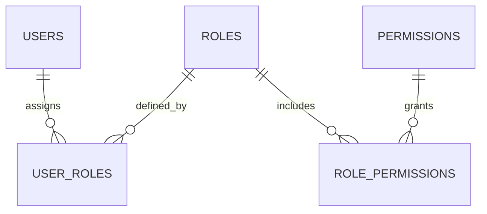

# 06 - Thiết kế Kiểm soát Truy cập (RBAC Design) - TicketBox

## 1. Nguyên tắc thiết kế Phân quyền (Access Control Principles)

Hệ thống TicketBox áp dụng mô hình **RBAC (Role-Based Access Control)** ở mức độ chi tiết (Granular Permission) kết hợp với **Row Level Security (RLS)** tại PostgreSQL để bảo vệ dữ liệu.

**Các nguyên tắc cốt lõi:**
1. **Principle of Least Privilege**: Mỗi vai trò chỉ được cấp đúng quyền cần thiết.
2. **Separation of Duties**: Check-in Staff không được quản lý vé, Organizer không quản lý phân quyền hệ thống.
3. **Role-based Assignment**: Quyền không gán trực tiếp cho user mà qua Role để dễ bảo trì.

---

## 2. Ma trận Phân quyền Hệ thống (Permission Matrix)

| Mã quyền (Permission Code) | Ý nghĩa chức năng                     | Audience | Organizer | Check-in Staff | System Admin |
|----------------------------|---------------------------------------|----------|-----------|----------------|--------------|
| `concert:read`             | Xem danh sách/chi tiết concert        | **X**    | **X**     | **X**          | **X**        |
| `concert:create`           | Tạo concert mới                       |          | **X**     |                | **X**        |
| `concert:update`           | Chỉnh sửa concert                     |          | **X**     |                | **X**        |
| `order:create`             | Tạo đơn mua vé                        | **X**    |           |                |              |
| `order:read_own`           | Xem đơn hàng cá nhân                  | **X**    |           |                | **X**        |
| `order:read_all`           | Xem tất cả đơn hàng                   |          | **X**     |                | **X**        |
| `ticket:view_own`          | Xem vé cá nhân                        | **X**    |           |                | **X**        |
| `ticket:validate`          | Quét & check-in vé                    |          |           | **X**          | **X**        |
| `vip:import`               | Import CSV khách VIP                  |          | **X**     |                | **X**        |
| `ai:generate_bio`          | Tạo Artist Bio từ PDF                 |          | **X**     |                | **X**        |
| `rbac:manage`              | Quản lý User, Role, Permission        |          |           |                | **X**        |
| `report:view`              | Xem báo cáo doanh thu                 |          | **X**     |                | **X**        |

---
## 2.1. Sơ đồ Quan hệ Phân quyền (RBAC Model)
Sơ đồ minh họa cách hệ thống phân rã quyền hạn thông qua các bảng trung gian để đạt tính linh hoạt cao:


---

## 3. Ánh xạ Phân quyền vào API Endpoints

| HTTP Method | Endpoint                        | Required Permission     | Ghi chú |
|-------------|---------------------------------|-------------------------|---------|
| `GET`       | `/api/v1/concerts`              | `concert:read`          | Công khai |
| `POST`      | `/api/v1/concerts`              | `concert:create`        | Organizer / Admin |
| `POST`      | `/api/v1/orders`                | `order:create`          | Audience |
| `GET`       | `/api/v1/orders/me`             | `order:read_own`        | User cá nhân |
| `GET`       | `/api/v1/orders`                | `order:read_all`        | Organizer / Admin |
| `POST`      | `/api/v1/checkin/validate`      | `ticket:validate`       | Staff |
| `POST`      | `/api/v1/checkin/sync`          | `ticket:validate`       | Staff |
| `POST`      | `/api/v1/imports/csv`           | `vip:import`            | Organizer |
| `POST`      | `/api/v1/ai/artist-bio`         | `ai:generate_bio`       | Organizer |

---

## 4. Cơ chế Thực thi Phân quyền Bảo mật (Enforcement Mechanisms)

### 4.1. Lớp 1: JWT + RBAC Middleware (Backend API)

- Khi đăng nhập, hệ thống thu thập permissions từ `user_roles` và `role_permissions`.
- Đóng gói vào JWT Payload.
- Mỗi request sẽ được RBAC Middleware kiểm tra quyền trước khi vào Controller.
- Không đủ quyền → trả về **403 Forbidden**.

### 4.2. Lớp 2: Row Level Security (RLS) tại PostgreSQL

Ví dụ policy cho bảng `orders`:

```sql
ALTER TABLE orders ENABLE ROW LEVEL SECURITY;

-- Khán giả chỉ xem đơn của mình
CREATE POLICY audience_view_own_orders ON orders
    FOR SELECT TO authenticated
    USING (auth.uid() = user_id);

-- Organizer xem tất cả
CREATE POLICY organizer_view_all_orders ON orders
    FOR SELECT TO authenticated
    USING (
        EXISTS (
            SELECT 1 FROM user_roles ur
            JOIN roles r ON ur.role_id = r.id
            WHERE ur.user_id = auth.uid() AND r.name = 'ORGANIZER'
        )
    );

```

    
## 5. Trade-off của thiết kế RBAC

| Ưu điểm                                      | Nhược điểm                                      |
|----------------------------------------------|-------------------------------------------------|
| Dễ quản lý và audit quyền hạn                | Phải invalidate cache permission khi thay đổi role |
| Bảo mật nhiều lớp (JWT + Middleware + RLS)   | JWT payload có thể lớn nếu số quyền nhiều       |
| Dễ mở rộng khi thêm role hoặc permission mới | Cần viết và quản lý RLS Policy cẩn thận         |
| Phù hợp với quy mô team nhỏ và thời gian ngắn | Ít linh hoạt hơn ABAC                           |

## 6. Kết luận

Thiết kế RBAC kết hợp RLS giúp hệ thống TicketBox đảm bảo tính bảo mật, dễ bảo trì và phù hợp với các luồng nghiệp vụ đã
