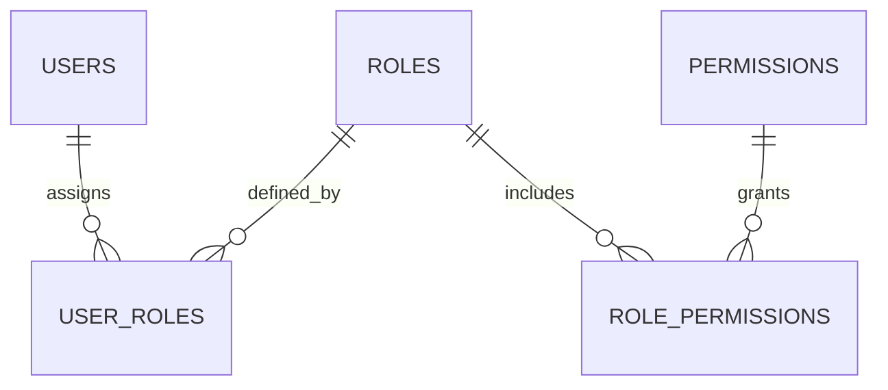

# 06 - Thiết kế Kiểm soát Truy cập (RBAC Design) - TicketBox

## 1. Nguyên tắc thiết kế Phân quyền (Access Control Principles)

Hệ thống TicketBox áp dụng mô hình **RBAC (Role-Based Access Control)** ở mức permission chi tiết. Cơ chế thực thi chính nằm tại Backend API bằng JWT, RBAC Guard và kiểm tra quyền sở hữu dữ liệu. PostgreSQL Row Level Security (RLS) được xem là lớp defense-in-depth có thể bổ sung sau, không phải yêu cầu bắt buộc của prototype.

**Các nguyên tắc cốt lõi:**
1. **Principle of Least Privilege**: Mỗi vai trò chỉ được cấp đúng quyền cần thiết.
2. **Separation of Duties**: Check-in Staff không được quản lý vé, Organizer không quản lý phân quyền hệ thống.
3. **Role-based Assignment**: Quyền không gán trực tiếp cho user mà qua Role để dễ bảo trì.

---

## 2. Ma trận Phân quyền Hệ thống (Permission Matrix)

| Mã quyền (Permission Code) | Ý nghĩa chức năng                     | Audience | Organizer | Check-in Staff | System Admin |
|----------------------------|---------------------------------------|----------|-----------|----------------|--------------|
| `concert:read`             | Xem danh sách/chi tiết concert        | **X**    | **X**     | **X**          | **X**        |
| `concert:create`           | Tạo concert mới                       |          | **X**     |                | **X**        |
| `concert:update`           | Chỉnh sửa concert                     |          | **X**     |                | **X**        |
| `order:create`             | Tạo đơn mua vé                        | **X**    |           |                |              |
| `order:read_own`           | Xem đơn hàng cá nhân                  | **X**    |           |                | **X**        |
| `order:read_all`           | Xem tất cả đơn hàng                   |          | **X**     |                | **X**        |
| `ticket:view_own`          | Xem vé cá nhân                        | **X**    |           |                | **X**        |
| `ticket:validate`          | Quét & check-in vé                    |          |           | **X**          | **X**        |
| `vip:import`               | Import CSV khách VIP                  |          | **X**     |                | **X**        |
| `ai:generate_bio`          | Tạo Artist Bio từ PDF                 |          | **X**     |                | **X**        |
| `rbac:manage`              | Quản lý User, Role, Permission        |          |           |                | **X**        |
| `report:view`              | Xem báo cáo doanh thu                 |          | **X**     |                | **X**        |

---
## 2.1. Sơ đồ Quan hệ Phân quyền (RBAC Model)
Sơ đồ minh họa cách hệ thống phân rã quyền hạn thông qua các bảng trung gian để đạt tính linh hoạt cao:


---

## 3. Ánh xạ Phân quyền vào API Endpoints

| HTTP Method | Endpoint                        | Required Permission     | Ghi chú |
|-------------|---------------------------------|-------------------------|---------|
| `GET`       | `/api/v1/concerts`              | `concert:read`          | Công khai |
| `POST`      | `/api/v1/concerts`              | `concert:create`        | Organizer / Admin |
| `POST`      | `/api/v1/orders`                | `order:create`          | Audience |
| `GET`       | `/api/v1/orders/me`             | `order:read_own`        | User cá nhân |
| `GET`       | `/api/v1/orders`                | `order:read_all`        | Organizer / Admin |
| `POST`      | `/api/v1/checkin/validate`      | `ticket:validate`       | Staff |
| `POST`      | `/api/v1/checkin/sync`          | `ticket:validate`       | Staff |
| `POST`      | `/api/v1/imports/csv`           | `vip:import`            | Organizer |
| `POST`      | `/api/v1/ai/artist-bio`         | `ai:generate_bio`       | Organizer |

---

## 4. Cơ chế Thực thi Phân quyền Bảo mật (Enforcement Mechanisms)

### 4.1. Lớp 1: JWT Authentication

Sau khi đăng nhập thành công, Backend phát hành access token có thời gian sống ngắn. JWT chỉ chứa các claim tối thiểu:

```json
{
  "sub": "user-id",
  "roles": ["ORGANIZER"],
  "permission_version": 4,
  "jti": "token-id",
  "exp": 1710000000
}
```

Không đóng gói toàn bộ danh sách permission vào JWT vì permission có thể thay đổi trong khi token vẫn còn hiệu lực. Cách này giúp token nhỏ hơn và hạn chế tình trạng quyền cũ bị giữ đến khi token hết hạn.

### 4.2. Lớp 2: RBAC Guard và Permission Cache tại Backend

Mỗi request đi qua quy trình:

1. JWT Guard xác minh chữ ký, thời hạn và lấy `user_id`, `roles`, `permission_version`.
2. RBAC Guard tra permission theo key Redis, ví dụ `rbac:user:{userId}:v{permissionVersion}`.
3. Nếu cache miss, Backend đọc `user_roles`, `role_permissions` và `permissions` từ PostgreSQL rồi ghi cache với TTL ngắn.
4. Guard so sánh permission yêu cầu của endpoint với permission hiện tại của user.
5. Không đủ quyền thì trả `403 Forbidden`.

Khi Admin thay đổi role/permission của user:

- Tăng `permission_version` của user trong PostgreSQL.
- Xóa các key permission cache liên quan trong Redis.
- Token có version cũ bị yêu cầu refresh/login lại khi Backend phát hiện version không còn hợp lệ.

### 4.3. Lớp 3: Kiểm tra quyền sở hữu dữ liệu

RBAC trả lời câu hỏi “role này có được phép thực hiện hành động không”, nhưng các endpoint như `order:read_own` còn phải kiểm tra ownership.

Ví dụ:

```text
GET /api/v1/orders/:id
→ kiểm tra permission order:read_own
→ truy vấn order với điều kiện id = :id AND user_id = authenticatedUserId
→ không tìm thấy hoặc không sở hữu thì trả 404/403 theo policy
```

Tương tự, Organizer chỉ được sửa concert thuộc phạm vi tổ chức của mình nếu hệ thống hỗ trợ nhiều ban tổ chức.

### 4.4. Row Level Security là lớp tùy chọn

Trong phạm vi prototype, Backend API là lớp enforce quyền chính. PostgreSQL RLS chỉ nên được bổ sung khi nhóm có nhu cầu defense-in-depth và có thể quản lý đúng session context trên connection pool.

Không sử dụng trực tiếp `auth.uid()` vì đây không phải hàm PostgreSQL tiêu chuẩn trong kiến trúc hiện tại. Nếu triển khai RLS, Backend phải đặt user context theo từng transaction/connection, chẳng hạn thông qua `SET LOCAL app.current_user_id`, sau đó policy đọc giá trị bằng `current_setting(...)`. Cách này cần được kiểm thử kỹ để tránh rò rỉ context giữa các connection trong pool.

### 4.5. Kiểm soát tại giao diện

Audience Web, Admin Web và Mobile App có thể ẩn menu hoặc button không phù hợp với role để cải thiện UX. Tuy nhiên, ẩn UI không phải cơ chế bảo mật; Backend API luôn phải kiểm tra quyền lại.

---

## 5. Trade-off của thiết kế RBAC

| Ưu điểm | Nhược điểm / Đánh đổi |
|---|---|
| JWT phù hợp cho cả web và mobile, Backend dễ scale ngang | Cần access token ngắn hạn, refresh/revocation strategy |
| Permission không nằm toàn bộ trong JWT nên thay đổi quyền phản ánh nhanh hơn | Mỗi request cần đọc Redis hoặc fallback PostgreSQL |
| Redis cache giảm tải truy vấn permission | Phải invalidate cache và quản lý `permission_version` đúng |
| RBAC dễ hiểu, dễ audit, phù hợp role của TicketBox | Kém linh hoạt hơn ABAC cho rule dựa trên nhiều thuộc tính |
| Ownership check bảo vệ dữ liệu cá nhân | Cần viết điều kiện scope nhất quán ở repository/service |
| RLS có thể bổ sung như defense-in-depth | Tăng độ phức tạp với connection pooling, không bắt buộc cho prototype |

## 6. Kết luận

TicketBox chọn **JWT Authentication + Backend RBAC Guard + Permission Cache + Ownership Check** làm cơ chế chính. Thiết kế này phù hợp với web/mobile, giữ Backend gần stateless, cho phép cập nhật quyền mà không phải nhét toàn bộ permission vào token và vừa sức với team 3 người. PostgreSQL RLS được giữ ở mức phương án mở rộng, chỉ triển khai khi nhóm có đủ thời gian kiểm thử session context và connection pool.
