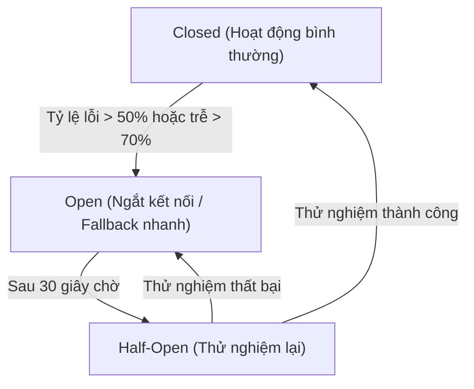
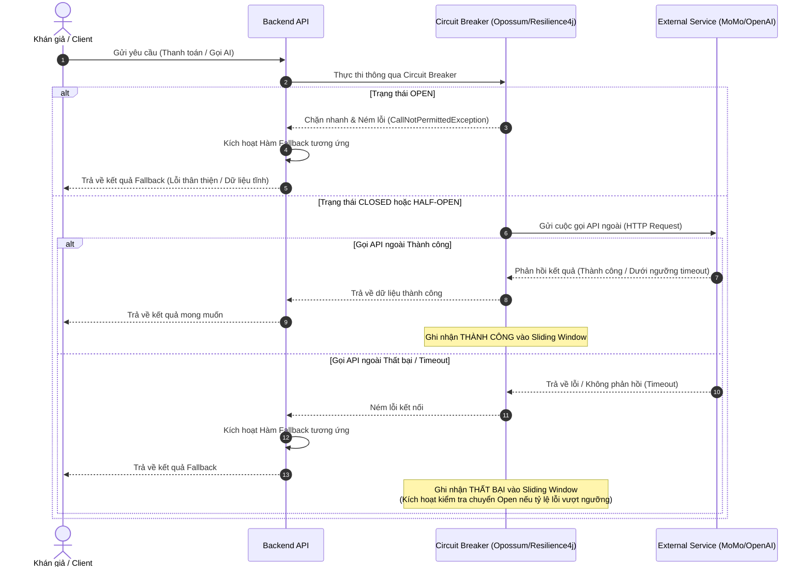

# Mục 7: Thiết Kế Cơ Chế Bảo Vệ Hệ Thống (Protection Mechanisms)

Tài liệu này đặc tả chi tiết các cơ chế kỹ thuật và giải pháp kiến trúc nhằm bảo vệ hệ thống **TicketBox** khỏi tình trạng quá tải (high load), chống bot spam, xử lý tranh chấp vé thời gian thực, quản lý lỗi tích hợp bên thứ ba và đảm bảo an toàn soát vé khi mất kết nối mạng.

---

## 1. Giới Hạn Tần Suất Truy Cập (Rate Limiting)

Để bảo vệ Backend API khỏi các cuộc tấn công DDoS, bot quét vé, và tình trạng người dùng bấm F5 liên tục khi mở bán, hệ thống cấu hình rate limit phân tầng tại lớp **API Gateway** và sử dụng **Redis** làm bộ lưu trữ trạng thái.

### 1.1. Giải thuật áp dụng
Hệ thống sử dụng **Sliding Window Log** trên Redis Sorted Set cho prototype: mỗi cặp `IP + Endpoint` hoặc `User ID + Endpoint` là một key, còn score là timestamp request. Cách này dễ minh họa và có độ chính xác tốt; ở production có thể chuyển sang Sliding Window Counter hoặc token bucket để giảm bộ nhớ.

### 1.2. Bảng cấu hình Rate Limiting chi tiết
Hệ thống phân chia giới hạn theo tính chất của từng API:

| Nhóm API | Endpoint | Định danh | Giới hạn (Rate Limit) | Hành động khi vượt ngưỡng |
| :--- | :--- | :--- | :--- | :--- |
| **Public Read** | `GET /concerts`<br>`GET /concerts/:id` | Theo Địa chỉ IP | 100 requests / 1 phút | Trả về HTTP `429 Too Many Requests` kèm Header `Retry-After`. |
| **Nghiệp vụ Mua vé**| `POST /orders`<br>`POST /payments` | Theo User ID (JWT Token) | 5 requests / 1 phút | Trả về HTTP `429` kèm cảnh báo *"Thao tác quá nhanh, vui lòng thử lại sau 1 phút."* |
| **Soát vé di động** | `POST /checkin/verify` | Theo Device ID + Staff ID | 60 requests / 1 phút | Giới hạn để tránh lỗi vòng lặp của app. Nếu vượt quá, thông báo cho nhân sự kiểm tra lại thiết bị. |
| **Đồng bộ offline** | `POST /checkin/sync` | Theo Device ID + Staff ID | 10 requests / 1 phút | Tải trọng đồng bộ gói tin lớn, cần hạn chế tần suất gọi API sync liên tục. |
| **Tác vụ Admin** | `POST /csv-imports`<br>`POST /ai/artist-bio`| Theo Staff ID | 3 requests / 1 phút | Giới hạn tần suất tải file CSV và PDF để tránh quá tải bộ nhớ. |

> Các ngưỡng trên là **giá trị khởi tạo cho prototype**, không phải cam kết production. Chúng cần được hiệu chỉnh dựa trên load test, kích thước connection pool, latency database và hành vi người dùng thực tế.

### 1.3. Cơ chế Phòng chờ ảo (Virtual Waiting Room) — phương án nâng cao

Đối với các concert có tải đỉnh cực lớn (ví dụ: 80.000 user truy cập đồng thời trong 5 phút đầu mở bán vé Chị Đẹp Đạp Gió Rẽ Sóng), việc chỉ áp dụng Rate Limiting là chưa đủ. Nếu 10.000 request vượt qua lớp lọc rate limit và gửi đồng thời lệnh tạo đơn hàng `POST /orders`, database PostgreSQL sẽ bị cạn kiệt connection pool do hàng đợi khóa dòng bi quan `FOR UPDATE` bị kéo dài.

Để san phẳng tải trước khi request đi vào PostgreSQL, Blueprint đề xuất **Phòng chờ ảo (Virtual Waiting Room)** như một phương án nâng cao. Prototype có thể chỉ triển khai rate limiting và mô phỏng queue token; bản production cần load test, chống giả mạo token và cơ chế phục hồi khi Redis/worker lỗi.

1. **Phân luồng lưu lượng (Traffic throttling)**:
   - Khi lưu lượng `POST /orders` vượt ngưỡng vận hành đã được xác định bằng load test, API Gateway kích hoạt chế độ phòng chờ. Con số như `200 requests/giây` chỉ là ví dụ cấu hình ban đầu, không phải ngưỡng cố định.
   - Các request đến sau sẽ không được xử lý trực tiếp mà được đưa vào hàng đợi chờ trên Redis (Sorted Set `waiting_room:queue` với score là timestamp của request).
2. **Trải nghiệm hàng chờ (Queue UX)**:
   - Client nhận phản hồi HTTP `202 Accepted` kèm một `queue_token` và thông tin hàng chờ.
   - Client hiển thị màn hình phòng chờ với thời gian chờ ước lượng và số thứ tự chờ (được tính bằng hàm `ZRANK` trên Redis).
   - Client định kỳ mỗi 5-10 giây gọi API `GET /orders/queue-status` để kiểm tra trạng thái token.
3. **Giải phóng hàng chờ (Queue release)**:
   - Worker giải phóng token theo từng batch nhỏ từ Redis Sorted Set sang trạng thái "Được phép tạo order" (`waiting_room:active_tokens`). Kích thước batch và chu kỳ release phải được hiệu chỉnh theo capacity thực tế của Backend/PostgreSQL; các giá trị `100 token/2 giây` chỉ mang tính minh họa.
   - Khi client kiểm tra trạng thái token thấy đã chuyển sang "Được phép thanh toán", client sẽ tự động gửi request tạo đơn hàng thực sự lên backend. Lúc này backend sẽ xử lý transaction trừ vé bình thường.
4. **Bảo vệ hệ thống (Load flattening)**:
   - Phòng chờ giúp san phẳng đỉnh tải thành lưu lượng gần với capacity đã kiểm thử của hệ thống. Cơ chế FIFO theo thời điểm cấp token cải thiện tính công bằng, nhưng không thể cam kết công bằng tuyệt đối do độ trễ mạng, retry, client mất kết nối và các trường hợp token hết hạn.

---

## 2. Cơ Chế Bộ Đệm (Caching)

Để giảm tải cho PostgreSQL Database chính khi có hàng vạn người xem concert cùng lúc, hệ thống sử dụng **Redis Cache** theo mô hình **Cache-Aside** (Đọc từ cache trước, nếu không có thì đọc từ DB và ghi vào cache).

### 2.1. Biến động dữ liệu và TTL (Time-To-Live) tương ứng
Dữ liệu được phân cấp theo tần suất thay đổi để thiết lập thời gian sống (TTL) và cơ chế invalidate (hủy cache) phù hợp:

| Loại dữ liệu | Khóa Cache (Key) | TTL đề xuất | Cơ chế đồng bộ / Invalidate |
| :--- | :--- | :--- | :--- |
| **Danh sách Concert** | `concerts:published:list` | 60 giây | Tự động hết hạn. Khi Admin cập nhật concert mới, hệ thống chủ động xóa key này. |
| **Chi tiết Concert** | `concerts:detail:{id}` | 120 giây | Hủy cache ngay khi BTC cập nhật hoặc hủy concert thông qua Admin Web. |
| **Số lượng vé còn lại** | `tickets:availability:{id}` | 5 - 10 giây | Dữ liệu thay đổi rất nhanh. Chỉ cache ngắn để giảm tải lúc cao điểm. Database vẫn là nguồn xác thực cuối khi tạo order. |
| **Quyền hạn người dùng**| `rbac:user:{id}:permissions` | 5 phút | Hủy cache ngay khi Admin thay đổi vai trò hoặc quyền của user. |

---

## 3. Xử Lý Tranh Chấp Vé Thời Gian Thực (Race Condition Handling)

Đây là bài toán trọng tâm khi có 200 vé SVIP nhưng có 10.000 người cùng bấm mua tại một thời điểm. Hệ thống kết hợp cơ chế kiểm soát của **PostgreSQL Transaction** và **Row-level Lock** để đảm bảo không xảy ra hiện tượng bán vượt số lượng (oversell).

### 3.1. Quy trình trừ vé an toàn (Strict Ticket Deduction Flow)
Khi Khán giả thực hiện tạo đơn hàng mua vé, Backend API thực hiện các bước sau trong một Transaction duy nhất:

```sql
-- Bước 1: Mở Transaction
BEGIN;

-- Bước 2: Truy vấn và khóa dòng dữ liệu của hạng vé tương ứng
-- Lệnh FOR UPDATE sẽ chặn các transaction khác muốn đọc/ghi dòng này cho đến khi transaction hiện tại kết thúc
SELECT sold_quantity, total_quantity, max_per_user 
FROM ticket_types 
WHERE id = ? FOR UPDATE;

-- Bước 3: Kiểm tra nghiệp vụ tại Backend API:
-- - Kiểm tra: (sold_quantity + requested_quantity) <= total_quantity
-- - Kiểm tra: (số vé đã mua lũy kế + requested_quantity) <= max_per_user

-- Bước 4: Nếu hợp lệ, cập nhật số lượng vé đã bán
UPDATE ticket_types 
SET sold_quantity = sold_quantity + ? 
WHERE id = ?;

-- Bước 5: Tạo đơn hàng tạm thời ở trạng thái PENDING_PAYMENT
INSERT INTO orders (id, user_id, status, expires_at) 
VALUES (?, ?, 'PENDING_PAYMENT', NOW() + INTERVAL '10 minutes');

-- Bước 6: Commit Transaction để giải phóng khóa dòng
COMMIT;
```

### 3.2. Đánh giá Trade-off
* **Ưu điểm:** PostgreSQL transaction và row-level lock cung cấp cơ chế nhất quán mạnh tại điểm cập nhật tồn vé. Thiết kế nhằm ngăn oversell khi transaction, constraint và xử lý timeout/rollback được triển khai đúng.
* **Nhược điểm:** Khi nhiều request cùng tranh một `ticket_type`, lock contention có thể tăng latency và làm cạn connection pool. Transaction phải được giữ ngắn, request cần được lọc trước bằng rate limiting/waiting room, và throughput thực tế phải được xác nhận bằng load test trên hạ tầng triển khai.

---

## 4. Cơ Chế Chống Trùng Lặp Giao Dịch (Idempotency Key)

Khi mạng chập chờn, Khán giả có thể bấm nút "Thanh toán" liên tiếp nhiều lần, hoặc cổng thanh toán gửi webhook trùng lặp. Hệ thống thiết lập cơ chế **Idempotency** để đảm bảo một yêu cầu thanh toán chỉ được thực thi duy nhất một lần.

### 4.1. Quy trình thực hiện
1. **Sinh Key:** Khi Khán giả bấm nút thanh toán, `Audience Web App` tự động sinh ra một mã UUID duy nhất gọi là `idempotency_key` và đính kèm vào HTTP Header `Idempotency-Key` của request gửi lên server.
2. **Kiểm tra trùng:** `Backend API` nhận request và kiểm tra `idempotency_key` này trong bảng `payments` hoặc Redis.
3. **Phản hồi:**
   - **Nếu key chưa tồn tại:** Server tiến hành tạo giao dịch thanh toán mới, lưu `idempotency_key` vào DB và gọi sang Cổng thanh toán.
   - **Nếu key đã tồn tại trong DB/Redis:** Server không thực hiện giao dịch mới, chỉ trả về ngay lập tức kết quả của giao dịch trước đó (ví dụ: đang chờ thanh toán, hoặc đã thanh toán thành công).

---

## 5. Trình Ngắt Mạch Tích Hợp (Circuit Breaker)

Hệ thống TicketBox phụ thuộc lớn vào các dịch vụ bên ngoài (External Services) như **Payment Gateway** (VNPAY/MoMo) và **AI Service** (OpenAI/Gemini). Nếu các dịch vụ này bị chậm hoặc sập, hệ thống dễ bị cạn kiệt tài nguyên (connection pool, threads) do phải chờ đợi phản hồi. Để giải quyết vấn đề này, cơ chế Circuit Breaker được tích hợp nhằm cô lập các lỗi từ bên thứ ba, đảm bảo tính sẵn sàng (high availability) của hệ thống chính.

### 5.1. Thiết kế 3 trạng thái của Circuit Breaker
Hệ thống sử dụng thư viện (như `Resilience4j` hoặc `opossum` trong Node.js) để bọc các hàm gọi API ngoài:



Chi tiết luồng chuyển dịch và điều kiện kích hoạt:
* **Trạng thái Closed (Đóng):**
  * Hệ thống cho phép tất cả các request đến dịch vụ bên ngoài bình thường.
  * Sử dụng cơ chế **Sliding Window** (Cửa sổ trượt - dạng đếm hoặc thời gian) để thu thập kết quả của các cuộc gọi (Thành công, Thất bại, Gọi chậm).
  * Điều kiện chuyển sang `Open`: Khi số lượng cuộc gọi tối thiểu được thực hiện trong cửa sổ trượt đạt ngưỡng và tỷ lệ lỗi (Failure Rate) vượt quá `50%` hoặc tỷ lệ cuộc gọi chậm (Slow Call Rate - phản hồi lâu hơn ngưỡng định nghĩa) vượt quá `70%`.
* **Trạng thái Open (Mở):**
  * Ngắt toàn bộ kết nối đến dịch vụ bên ngoài đó. Mọi request gửi tới dịch vụ này từ hệ thống sẽ bị chặn lập tức và trả về ngay kết quả dự phòng (Fallback) hoặc lỗi nhanh (Fail-fast) mà không gửi lên mạng. Cơ chế này giúp giải phóng connection pool và các luồng xử lý (threads) của backend.
  * Khởi động một bộ định thời (Timer) có thời gian chờ mặc định là `30 giây` (Wait Duration).
* **Trạng thái Half-Open (Nửa mở):**
  * Sau khi hết thời gian chờ của trạng thái `Open`, Circuit Breaker chuyển sang `Half-Open`.
  * Cho phép một lượng nhỏ request thử nghiệm (ví dụ: `10 requests`) đi qua để đo lường độ ổn định thực tế của dịch vụ bên thứ ba.
  * Nếu tỷ lệ lỗi của các cuộc gọi thử nghiệm này nằm dưới ngưỡng giới hạn quy định, Circuit Breaker tự động chuyển về `Closed` (phục hồi hoàn toàn).
  * Nếu phát hiện bất kỳ lỗi nghiêm trọng nào hoặc tỷ lệ lỗi vẫn vượt quá giới hạn, Circuit Breaker lập tức quay lại trạng thái `Open` và thiết lập lại bộ định thời chờ mới.

### 5.2. Bảng cấu hình tham số chi tiết cho từng dịch vụ ngoài

Mỗi dịch vụ ngoài có đặc tính nghiệp vụ và kỹ thuật khác nhau, do đó cần cấu hình các bộ tham số Circuit Breaker riêng biệt để tối ưu hóa trải nghiệm người dùng:

| Tham số cấu hình | Cổng Thanh Toán (VNPAY/MoMo) | Dịch Vụ AI (OpenAI/Gemini) | Giải thích |
| :--- | :--- | :--- | :--- |
| **Sliding Window Type** | Count-based (Theo số lượng) | Time-based (Theo thời gian) | Cách thức thu thập số liệu (dựa trên số lượng cuộc gọi hoặc thời gian trôi qua). |
| **Sliding Window Size** | 50 requests | 60 giây | Kích thước của cửa sổ trượt để đánh giá tỷ lệ lỗi. |
| **Failure Rate Threshold** | 50% | 60% | Tỉ lệ cuộc gọi thất bại (lỗi mạng, HTTP 5xx) để kích hoạt trạng thái Open. |
| **Slow Call Rate Threshold** | 70% | 80% | Tỉ lệ cuộc gọi chậm trên tổng số cuộc gọi để kích hoạt trạng thái Open. |
| **Slow Call Duration Threshold** | 5000 ms | 10000 ms | Ngưỡng thời gian (milliseconds) để xác định một cuộc gọi là chậm. |
| **Minimum Number of Calls** | 20 requests | 10 requests | Số lượng cuộc gọi tối thiểu trong cửa sổ trước khi tính toán tỷ lệ lỗi. |
| **Wait Duration in Open State** | 30 giây | 60 giây | Thời gian duy trì trạng thái Open trước khi chuyển sang Half-Open. |
| **Permitted Number of Calls in Half-Open** | 10 requests | 5 requests | Số lượng cuộc gọi thử nghiệm cho phép ở trạng thái Half-Open. |

### 5.3. Chiến lược dự phòng (Fallback Strategy)

Khi Circuit Breaker rơi vào trạng thái `Open`, hệ thống sẽ kích hoạt hàm Fallback tương ứng với từng dịch vụ để đảm bảo trải nghiệm người dùng không bị đứt gãy hoàn toàn:

1. **Đối với Cổng thanh toán (Payment Gateway):**
   * **Chiến lược:** Fail-fast kèm thông báo thân thiện và gợi ý giải pháp.
   * **Hành động cụ thể:** Hệ thống lập tức phản hồi lỗi với mã lỗi tùy chỉnh kèm thông báo: *"Cổng thanh toán hiện đang quá tải hoặc bảo trì. Vui lòng chọn phương thức thanh toán khác hoặc thử lại sau ít phút."* Đồng thời, hệ thống giữ nguyên trạng thái đơn hàng (Order) là `PENDING_PAYMENT` và cho phép người dùng thực hiện thanh toán lại trong vòng 10 phút hiệu lực giữ vé, tránh việc hủy đơn hàng đột ngột của khách.
2. **Đối với Dịch vụ AI (AI Service - Tạo tiểu sử nghệ sĩ):**
   * **Chiến lược:** Degradation (Giảm cấp tính năng) - Trả về dữ liệu tĩnh / mặc định.
   * **Hành động cụ thể:** Thay vì hiển thị lỗi hệ thống hoặc chặn tính năng, hệ thống sẽ tự động lấy thông tin mô tả cơ bản của nghệ sĩ đã được Ban tổ chức nhập sẵn thủ công trong PostgreSQL Database từ trước, hoặc trả về văn bản mặc định: *"Thông tin tiểu sử chi tiết đang được cập nhật..."* Điều này giúp trang thông tin concert vẫn hoạt động bình thường mà không ảnh hưởng tới luồng mua bán vé chính.

### 5.4. Lưu đồ xử lý yêu cầu tích hợp Circuit Breaker

Dưới đây là sơ đồ tương tác thể hiện luồng đi của yêu cầu khi đi qua Circuit Breaker:



---

## 6. Xử Lý Tác Vụ Ngầm Qua Hàng Đợi (Queue Processing)

Các tác vụ tốn thời gian như xử lý file CSV khách VIP, trích xuất text từ PDF nghệ sĩ rồi gửi AI, và gửi email e-ticket sẽ được đẩy vào hàng đợi **BullMQ** (chạy trên nền Redis) để xử lý bất đồng bộ, giúp giải phóng luồng xử lý chính của Backend API.

### 6.1. Quy trình quản lý tác vụ ngầm
```
[Client Request] --> [Backend API]
                         │
                         ▼ (Đẩy Job vào Queue)
                  [Redis - BullMQ]
                         │
                         ▼ (Worker lấy Job xử lý ngầm)
                  [Queue Worker] ──> [Gửi Email / Gọi AI / Đọc CSV]
```

### 6.2. Cấu hình xử lý sự cố (Failure Handling)
* **Retry Policy:** Khi worker xử lý lỗi (ví dụ gọi AI bị timeout hoặc SMTP email lỗi), job sẽ tự động được đưa vào danh sách retry sau 5 phút, tối đa retry 3 lần.
* **Dead Letter Queue (DLQ):** Nếu sau 3 lần retry vẫn thất bại, job sẽ chuyển sang trạng thái `FAILED`. Admin Web App sẽ hiển thị danh sách các job lỗi này kèm lý do cụ thể để BTC có thể kiểm tra và chạy lại thủ công.

---

## 7. Bảo Vệ Xác Thực Soát Vé Ngoại Tuyến (Offline Check-in Protection)

Khi soát vé tại sân vận động bị mất kết nối mạng, thiết bị soát vé di động phải chuyển sang chế độ offline. Cơ chế này cần hạn chế tối đa các gian lận trùng lặp vé (double-scanning).

### 7.1. Cơ chế phòng chống gian lận
1. **Phân vùng soát vé:** Ban tổ chức phân chia rõ ràng cổng vào cho Khán giả (ví dụ: Gate 1 chỉ soát vé GA, Gate 2 chỉ soát vé SVIP). Mobile App của từng cổng chỉ đồng bộ về SQLite local dữ liệu của hạng vé tương ứng. Điều này làm giảm kích thước database lưu trữ local và thu hẹp phạm vi gian lận.
2. **Khóa quét trùng local (Local Double-Scan Prevention):** Khi quét một vé offline, Mobile App ghi nhận ngay vào SQLite local trạng thái đã quét. Nếu vé đó được quét lại trên chính thiết bị đó, app lập tức chặn và báo động đỏ.
3. **Thuật toán giải quyết xung đột khi đồng bộ (Conflict Resolution Rules):**
   Khi mạng phục hồi, các thiết bị đồng thời đẩy log check-in (`scanned_at`, `device_id`, `ticket_id`) lên Backend API. Backend xử lý conflict theo thứ tự ưu tiên:
   - **Quy tắc thời gian (Timestamp Rule):** Lượt quét nào có `scanned_at` sớm nhất sẽ được PostgreSQL chấp nhận là hợp lệ (`status` = `SUCCESS`). Các lượt quét sau sẽ bị đánh dấu là lỗi (`status` = `CONFLICT`).
   - **Log Cảnh báo:** Hệ thống lưu lại toàn bộ các log `CONFLICT` (gồm thông tin thiết bị đã quét, thời gian quét lần 2) để ban tổ chức kiểm tra chéo tại cổng kiểm soát an ninh.
