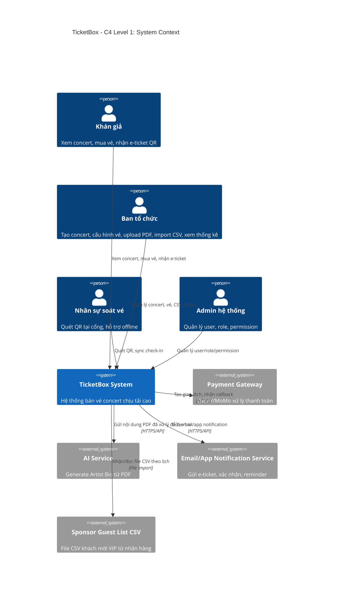
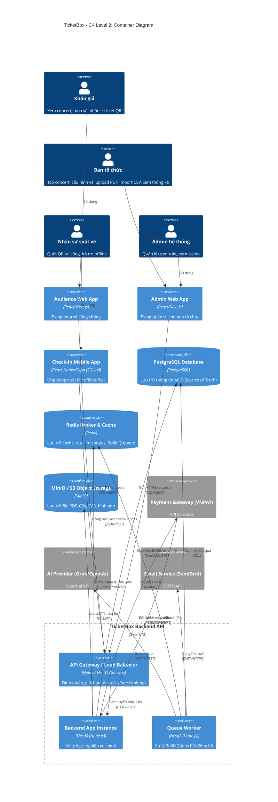
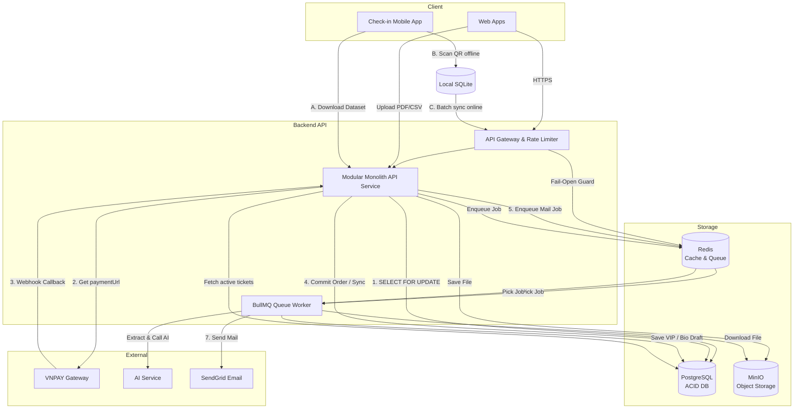

# TicketBox — Technical Design

Tài liệu này đặc tả chi tiết kiến trúc hệ thống, sơ đồ phân lớp, thiết kế cơ sở dữ liệu, ma trận phân quyền RBAC, các cơ chế bảo vệ và quyết định kỹ thuật (ADR) của hệ thống TicketBox.

---

## 1. Kiến trúc tổng thể (Overall Architecture)

TicketBox áp dụng mô hình kiến trúc **Modular Monolith (Đơn khối dạng module)** kết hợp **Layered Architecture (Kiến trúc phân lớp)** trong backend.

### 1.1. Lựa chọn kiến trúc
- **Modular Monolith**: Toàn bộ codebase được deploy chung trong một thực thể ứng dụng để giảm chi phí vận hành (DevOps) cho một team nhỏ (3 người). Tuy nhiên, code được phân rã thành các module độc lập rõ ràng (Auth, Concert, Order, Payment, Ticket, Checkin, Notification, AI, CSV Import). Ranh giới giữa các module được bảo vệ bằng quy tắc: không gọi trực tiếp Repository/Database của module khác mà phải đi qua Application Service của module đó. Thiết kế này giúp hệ thống dễ dàng tách thành các Microservices độc lập trong tương lai nếu cần.
- **Layered Architecture**: Mỗi module trong backend API tuân thủ cấu trúc phân lớp từ trên xuống dưới:
  ```text
  Controller/API Layer (Nhận/Validate request, định cấu hình Guards)
  └── Application Service Layer (Điều phối use case, quản lý database transaction)
      └── Domain Logic Layer (Quy tắc nghiệp vụ, tính toán tồn vé, kiểm tra giới hạn)
          └── Repository/Port Layer (Truy cập PostgreSQL/Redis hoặc định nghĩa Adapter)
  ```

### 1.2. Sơ đồ giao tiếp và luồng dữ liệu
Các Client (Audience Web, Admin Web, Check-in Mobile App) giao tiếp với Backend API thông qua giao thức RESTful API bảo mật trên nền HTTPS. 
- **PostgreSQL**: Đóng vai trò là kho lưu trữ dữ liệu ACID duy nhất (Source of Truth) cho các thực thể quan trọng.
- **Redis**: Dùng làm cache phân tán cho thông tin concert, availability tạm thời, rate limiting và waiting room.
- **BullMQ**: Đẩy các tác vụ tốn thời gian (gửi mail, import CSV, sinh bio AI) vào hàng đợi để worker xử lý bất đồng bộ, giải phóng luồng xử lý HTTP request chính.
- **Object Storage (MinIO/S3)**: Lưu trữ file nháp SVG seat map, PDF nghệ sĩ và CSV khách VIP.

---

## 2. Sơ đồ C4 (C4 Diagrams)

### 2.1. Level 1 — System Context
Sơ đồ mô tả ranh giới hệ thống TicketBox với các tác nhân (Actors) và các hệ thống bên ngoài (External Systems):



### 2.2. Level 2 — Container
Sơ đồ chi tiết hóa các container công nghệ bên trong hệ thống TicketBox và cách chúng tương tác:



---

## 3. High-Level Architecture Diagram
Sơ đồ luồng dữ liệu tại các điểm tích hợp ngoại vi và luồng check-in offline:



---

## 4. Thiết kế cơ sở dữ liệu (Database Design)

Hệ thống sử dụng **PostgreSQL** làm cơ sở dữ liệu quan hệ chính (ACID) kết hợp **Redis** cho bộ nhớ đệm và **MinIO/S3** cho dữ liệu tệp tin.

### 4.1. Thực thể chính và Schema
Chi tiết cấu trúc bảng dữ liệu được cài đặt trong PostgreSQL:

#### Bảng `users` (Identity & RBAC)
- `id` (UUID, PK)
- `email` (VARCHAR(255), UNIQUE, INDEX)
- `name` (VARCHAR(100))
- `password_hash` (VARCHAR(255))
- `permission_version` (INTEGER, DEFAULT 1) — Dùng để invalidate Redis permission cache lập tức khi thay đổi quyền.
- `is_active` (BOOLEAN, DEFAULT true)

#### Bảng `ticket_types` (Inventory)
- `id` (UUID, PK)
- `concert_id` (UUID, FK)
- `name` (VARCHAR(100)) — e.g. GA, SVIP, VIP, CAT1.
- `price` (NUMERIC(15,2))
- `total_quantity` (INTEGER) — Tổng số lượng vé phát hành.
- `sold_quantity` (INTEGER) — Số vé đã bán (khi payment confirmed).
- `held_quantity` (INTEGER) — Số vé đang giữ (khi order pending).
- `max_per_user` (INTEGER, DEFAULT 4)
- **Constraint (CHECK)**: `sold_quantity + held_quantity <= total_quantity` — ràng buộc cứng tại tầng database để ngăn chặn tuyệt đối tình trạng bán vượt số lượng vé quy định (Oversell).

#### Bảng `orders` (Giao dịch đặt vé)
- `id` (UUID, PK)
- `user_id` (UUID, FK, INDEX)
- `concert_id` (UUID)
- `ticket_type_id` (UUID)
- `quantity` (INTEGER)
- `total_amount` (NUMERIC(15,2))
- `status` (ENUM: `PENDING_PAYMENT`, `PAID`, `EXPIRED`, `CANCELLED`)
- `expires_at` (TIMESTAMPTZ) — Thời điểm hết hạn giữ vé (10 phút).
- **Index**: Composite index `(user_id, status)` để phục vụ truy vấn tìm đơn hàng cá nhân nhanh chóng.

#### Bảng `payments` (Lịch sử thanh toán)
- `id` (UUID, PK)
- `order_id` (UUID, FK, INDEX)
- `idempotency_key` (VARCHAR, UNIQUE) — Chống trùng lặp yêu cầu thanh toán từ Client (định dạng `userId:orderId`).
- `provider_tx_id` (VARCHAR, UNIQUE, NULLABLE) — Transaction ID từ cổng VNPAY/MoMo để chống xử lý callback trùng 2 lần.
- `provider` (VARCHAR(50)) — 'VNPAY' | 'MOMO'
- `amount` (NUMERIC(15,2))
- `status` (ENUM: `PENDING`, `CONFIRMED`, `FAILED`, `REFUNDED`)
- `raw_callback` (JSONB) — Lưu toàn bộ payload callback phục vụ đối soát.

#### Bảng `tickets` (E-Tickets phát hành)
- `id` (UUID, PK)
- `order_id` (UUID, FK, INDEX)
- `ticket_type_id` (UUID, FK)
- `user_id` (UUID, INDEX)
- `concert_id` (UUID)
- `qr_token` (VARCHAR, UNIQUE) — HMAC-signed opaque token, không chứa thông tin cá nhân.
- `manual_code` (VARCHAR(12), UNIQUE, INDEX) — Dùng cho nhân viên nhập tay khi camera hỏng.
- `status` (ENUM: `ACTIVE`, `USED`, `CANCELLED`, `TRANSFERRED`)

#### Bảng `checkin_logs` (Lịch sử soát vé)
- `id` (UUID, PK)
- `ticket_id` (UUID, INDEX)
- `concert_id` (UUID)
- `staff_id` (UUID)
- `device_id` (VARCHAR)
- `client_event_id` (UUID, UNIQUE) — UUID sinh ra ở thiết bị để đảm bộ sync offline idempotent.
- `mode` (ENUM: `ONLINE`, `OFFLINE`, `SYNCED`)
- `status` (ENUM: `ACCEPTED`, `REJECTED`, `CONFLICT`)
- `scanned_at` (TIMESTAMPTZ)
- **Index**: Composite index `(ticket_id, scanned_at)` để truy vấn nhanh lịch sử quét kiểm tra trùng lặp.

---

## 5. Thiết kế kiểm soát truy cập (RBAC Design)

TicketBox áp dụng ma trận phân quyền chi tiết dựa trên vai trò (**Role-Based Access Control - RBAC**). 

### 5.1. Ma trận phân quyền (Permission Matrix)

| Quyền | Audience | Organizer | Check-in Staff | System Admin |
|---|:---:|:---:|:---:|:---:|
| `concert:read` (Duyệt concert) | **X** | **X** | **X** | **X** |
| `concert:create` / `update` | | **X** | | **X** |
| `order:create` (Đặt vé) | **X** | | | |
| `order:read_own` (Xem vé mình) | **X** | | | **X** |
| `order:read_all` (Quản lý đơn) | | **X** | | **X** |
| `ticket:validate` (Soát vé) | | | **X** | **X** |
| `vip:import` (Import khách VIP) | | **X** | | **X** |
| `ai:generate_bio` (Dùng AI) | | **X** | | **X** |
| `rbac:manage` (Cấu hình quyền) | | | | **X** |
| `report:view` (Xem doanh thu) | | **X** | | **X** |

### 5.2. Cơ chế thực thi (Enforcement)
- **JWT Claim**: Client đính kèm JWT trong HTTP header. JWT chứa claim tối thiểu: `sub` (userId), `roles`, `permission_version`.
- **RBAC Guard (NestJS)**: Khi request đến, Guard lấy key `rbac:user:{userId}` từ Redis cache. Nếu cache miss, Guard truy vấn bảng `user_roles` và `role_permissions` từ PostgreSQL, nạp vào Redis với TTL 5 phút. Sau đó đối chiếu quyền yêu cầu của endpoint với quyền của User. Nếu không khớp trả về `403 Forbidden`.
- **Ownership & Scope Check**: Quyền `order:read_own` bắt buộc phải kiểm tra điều kiện `order.userId === currentUser.sub`. Organizer chỉ được xem báo cáo hoặc cập nhật concert do chính mình tạo ra (`concert.organizerId === currentUser.sub`).

---

## 6. Thiết kế các cơ chế bảo vệ hệ thống (Protection Mechanisms)

### 6.1. Kiểm soát tải đột biến (Rate Limiting)
Hệ thống sử dụng bộ lọc **Sliding Window Log (Cửa sổ trượt)** trên Redis Sorted Set để đếm chính xác số request của client trong cửa sổ thời gian 60 giây.
- **Ngưỡng giới hạn**:
  - `GET /concerts` (Public): 100 req/phút theo IP.
  - `POST /orders` & `POST /payments/*/initiate` (Đặt vé & Thanh toán): 5 req/phút theo User ID.
  - `POST /checkin/validate` (Soát vé): 60 req/phút theo Staff ID.
  - `POST /checkin/sync` (Sync offline): 10 req/phút theo Device ID.
  - CSV Import & AI Upload: 3 req/phút theo User ID.
- **Hành vi vượt ngưỡng**: Trả về `429 Too Many Requests` kèm Header `Retry-After: 60` để thông báo cho Client tự động khóa giao diện trong thời gian chờ.
- **Hạ cấp an toàn (Fail-Open)**: Nếu Redis gặp sự cố, bộ lọc Rate Limiting sẽ tự động cho phép request đi qua (Fail-Open) để không block người dùng thật, đồng thời log cảnh báo lỗi cho DevOps.

### 6.2. Xử lý cổng thanh toán không ổn định (Circuit Breaker)
Các cuộc gọi đến API VNPAY/MoMo hoặc AI Service được bảo vệ bằng thư viện `opossum` triển khai mô hình **Circuit Breaker (Cầu dao ngắt mạch)**:
- **Ngưỡng kích hoạt**: Nếu tỷ lệ cuộc gọi lỗi hoặc timeout (>10 giây cho VNPAY, >15 giây cho AI) vượt quá **50% trong vòng 10 giây**, Circuit Breaker chuyển sang trạng thái **OPEN** (Ngắt kết nối).
- **Graceful Degradation (Hạ cấp mềm)**: Khi Circuit OPEN, request thanh toán mới sẽ bị từ chối ngay lập tức với lỗi `503 Service Unavailable`, tránh làm tắc nghẽn backend. Tuy nhiên, luồng duyệt danh sách concert (chỉ đọc) vẫn hoạt động bình thường mà không bị ảnh hưởng.
- **Reset tự động**: Sau 30 giây (cho VNPAY) hoặc 60 giây (cho AI), circuit chuyển sang **HALF-OPEN** để gửi thử nghiệm một vài request. Nếu thành công, đóng mạch về **CLOSED**; nếu tiếp tục lỗi, mở mạch lại về **OPEN**.

### 6.3. Chống trừ tiền hai lần (Idempotency)
Để tránh rủi ro khách hàng nhấn nút thanh toán nhiều lần hoặc gateway gửi callback webhook trùng lặp:
- **Idempotency Key**: Request khởi tạo thanh toán yêu cầu client truyền header `idempotency-key` (sinh ra dạng `userId:orderId` hoặc UUID). Key này được lưu trong bảng `payments` với ràng buộc **UNIQUE**. Nếu trùng key, DB sẽ từ chối tạo bản ghi mới và trả về URL thanh toán cũ đã lưu.
- **Callback Deduplication**: Webhook callback từ VNPAY chứa mã giao dịch cổng thanh toán `provider_tx_id`. Trường này được cấu hình **UNIQUE** trong bảng `payments`. Khi nhận callback, server thực hiện transaction: kiểm tra `provider_tx_id` đã được xử lý chưa. Nếu đã xác nhận (`CONFIRMED`), server phản hồi thành công ngay lập tức cho gateway mà không cập nhật lại số lượng vé hay phát hành vé lần 2.

### 6.4. Caching (Cache-aside Pattern)
- **Danh sách Concert**: Lưu trên Redis với TTL **60 giây**. Khi Admin tạo/sửa concert, key cache bị xóa chủ động.
- **Chi tiết Concert**: Lưu trên Redis với TTL **120 giây**. Bị xóa chủ động khi có thay đổi từ Ban tổ chức.
- **Tình trạng tồn vé (Availability)**: Lưu trên Redis với TTL cực ngắn **5 - 10 giây**. Khi giao dịch đặt vé thành công, cache tồn vé của hạng vé đó bị xóa lập tức để client nhận được số liệu mới.
- **Lưu ý**: Cache tồn vé trên Redis chỉ phục vụ hiển thị nhanh ở client. Quyết định trừ vé cuối cùng khi click mua vẫn phải chạy transaction an toàn trong PostgreSQL dùng pessimistic lock `FOR UPDATE`.

---

## 7. Các quyết định kỹ thuật quan trọng (ADR - Architecture Decision Records)

Hệ thống TicketBox thống nhất thực hiện 13 quyết định kỹ thuật cốt lõi sau:

1. **ADR-01: Chọn Modular Monolith thay vì Microservices**  
   *Lý do*: Team nhỏ (3 người) phát triển trong 40 ngày. Modular Monolith giúp giảm thiểu độ phức tạp hạ tầng, CI/CD, service discovery và dễ quản lý transaction mua vé, nhưng vẫn đảm bảo chia module rõ ràng để có thể tách thành microservices sau này.
2. **ADR-02: Chọn Layered Architecture trong Backend**  
   *Lý do*: Tách biệt trách nhiệm rõ ràng (API Controller -> Service điều phối -> Domain Logic -> Repository truy cập dữ liệu). Giúp code dễ hiểu, dễ viết test và dễ bảo trì.
3. **ADR-03: Chọn PostgreSQL làm Database chính thay vì NoSQL**  
   *Lý do*: Luồng mua vé yêu cầu tính nhất quán ACID tuyệt đối. Ràng buộc quan hệ dữ liệu cao (User - Concert - TicketType - Order - Payment - Ticket). Cần constraint cứng chống oversell.
4. **ADR-04: Chọn Redis Cache-aside**  
   *Lý do*: Trang chủ và chi tiết concert bị đọc liên tục khi mở bán. Bộ đệm Cache-aside giúp giảm tải trên PostgreSQL, tự động fallback về DB khi Redis lỗi.
5. **ADR-05: Chọn Queue Worker cho CSV, AI, Notification**  
   *Lý do*: Gửi mail, phân tích PDF AI, stream CSV là tác vụ rất chậm. Đẩy vào hàng đợi BullMQ giúp phản hồi client tức thì, worker chạy nền tăng khả năng chịu lỗi.
6. **ADR-06: Chọn Payment Adapter + Circuit Breaker**  
   *Lý do*: Áp dụng Dependency Inversion (DIP). Service phụ thuộc cổng thanh toán thông qua interface `PaymentPort`. Opossum Circuit Breaker bảo vệ API chính không bị treo khi VNPAY sập.
7. **ADR-07: Chọn Idempotency Key cho Payment**  
   *Lý do*: Chống double charge tuyệt đối bằng database unique constraint trên `idempotency_key` và `provider_tx_id`.
8. **ADR-08: Chọn PostgreSQL Pessimistic Lock (`SELECT ... FOR UPDATE`) chống Oversell**  
   *Lý do*: Khi hàng nghìn người tranh mua vài vé cuối, optimistic lock sẽ gây xung đột phiên bản và rollback hàng loạt. Pessimistic lock tuần tự hóa việc trừ vé của cùng một hạng vé một cách an toàn.
9. **ADR-09: Chọn Offline-first Check-in có Sync thay vì Online-only**  
   *Lý do*: Sân vận động chập chập sóng. Mobile App tải trước danh sách vé, kiểm tra trùng trên SQLite cục bộ, sau đó đồng bộ idempotent qua `client_event_id` khi có mạng.
10. **ADR-10: Chọn Object Storage cho PDF/CSV/SVG**  
    *Lý do*: Tránh lưu file binary lớn trong PostgreSQL làm chậm database. Lưu file trên S3/MinIO giúp backend scale ngang dễ dàng.
11. **ADR-11: Chọn JWT + Backend RBAC Guard**  
    *Lý do*: JWT gọn nhẹ phù hợp cho cả Web và Mobile. Không nhét hết permissions vào JWT để tránh token bị phình to; thay vào đó, cache permissions trên Redis và invalidate theo `permission_version`.
12. **ADR-12: Chọn Seat Map theo Zone/SVG**  
    *Lý do*: Phù hợp yêu cầu concert bán vé theo khu vực (GA, VIP...). Giúp hiển thị trực quan sơ đồ tương tác mà không tăng độ phức tạp quản lý từng ghế đơn lẻ.
13. **ADR-13: Chọn Adapter Pattern cho AI/Notification**  
    *Lý do*: Dễ dàng hoán đổi nhà cung cấp AI (Grok, OpenAI) hoặc kênh thông báo (Email, SMS, App Push) bằng cách viết adapter mới mà không sửa logic nghiệp vụ chính.
