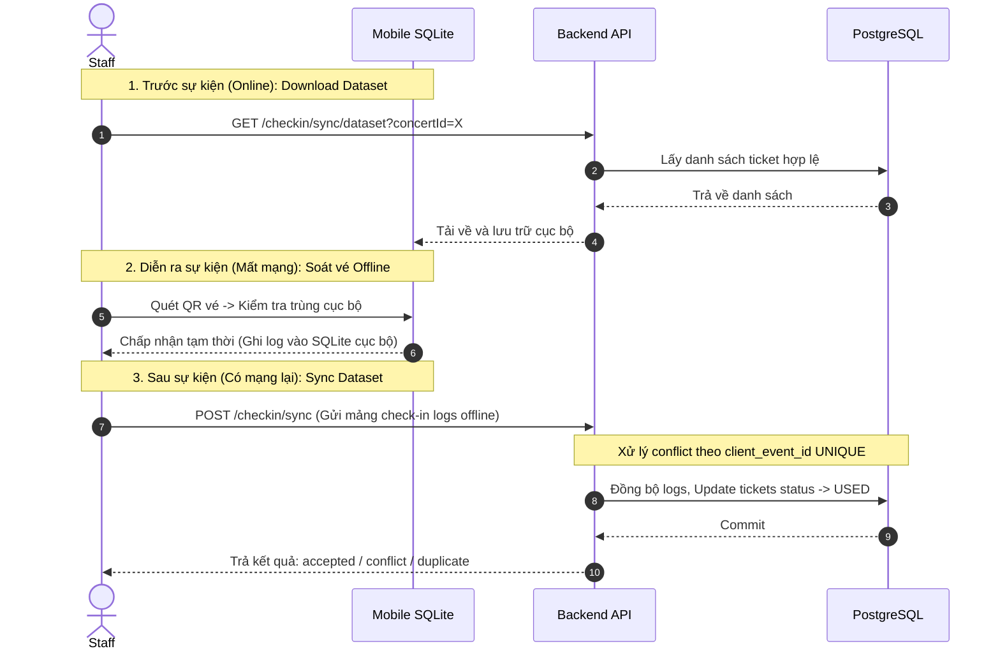

# Đặc tả: Luồng Soát Vé Online/Offline (checkin.md)

## 1. Mô tả
Cho phép nhân sự soát vé (Check-in Staff) quét mã QR soát vé tại cổng sự kiện trong hai chế độ: trực tuyến (Online) và ngoại tuyến (Offline) khi mất kết nối mạng di động. Đảm bảo dữ liệu soát vé được đồng bộ an toàn và không bị trùng lặp.

---

## 2. Luồng chính (Main Flow)

### Luồng Online
1. Staff quét mã QR trên vé. App gửi request `POST /checkin/validate` lên Backend API.
2. Server xác thực quyền `ticket:validate`.
3. Kiểm tra trạng thái vé trong PostgreSQL. Nếu vé có status = `ACTIVE`, cập nhật thành `USED`.
4. Tạo log `checkin_logs` với `mode = ONLINE`, `status = ACCEPTED`.
5. Trả về kết quả thành công cho app hiển thị giao diện xanh.

### Luồng Offline & Sync

---

## 3. Kịch bản lỗi (Exception Flows)

### ES-01: Vé quét trùng ở hai máy quét offline khác nhau (Conflict)
- **Điều kiện**: Cùng một vé QR được quét tại hai cổng soát vé offline khác nhau trong thời gian chưa đồng bộ.
- **Xử lý**: 
  1. Khi hai máy online trở lại và gọi API sync. Máy quét sync trước sẽ được server chấp nhận (`status = ACCEPTED`).
  2. Máy quét sync sau gửi cùng mã vé sẽ bị server từ chối vì vé đã được mark là `USED` bởi máy trước.
  3. Server tạo một log check-in đặc biệt với `status = CONFLICT`, lưu rõ thông tin thiết bị quét thứ hai để Ban tổ chức đối soát gian lận.

### ES-02: Đồng bộ lặp do mạng chập chờn (Sync Retry)
- **Điều kiện**: Thiết bị gửi batch logs lên server, server đã lưu thành công nhưng gói tin phản hồi bị drop do mất mạng. Thiết bị gửi lại batch đó lần nữa.
- **Xử lý**: Server dựa trên ràng buộc `UNIQUE` của `client_event_id` (sinh ra dạng UUID cho mỗi lượt quét trên mobile) để bỏ qua bản ghi trùng, không tạo thêm log soát vé lặp.

---

## 4. Ràng buộc (Constraints)
- **Tính nhất quán**: Server luôn là cơ quan quyết định cuối cùng (Final Authority). Dữ liệu SQLite trên Mobile chỉ mang tính chất đệm tạm thời.
- **Mã hoá**: QR token được ký HMAC chứa `ticketId` và `concertId` để Mobile App có thể giải mã kiểm tra tính hợp lệ cục bộ mà không cần truyền thông tin nhạy cảm của khách hàng.

---

## 5. Tiêu chí chấp nhận (Acceptance Criteria)
- SQLite trên Mobile App chặn hoàn toàn việc quét trùng một vé 2 lần trên cùng một thiết bị khi offline.
- Server phát hiện và ghi nhận đầy đủ tất cả các trường hợp xung đột (Conflict) khi đồng bộ dữ liệu từ nhiều máy.
