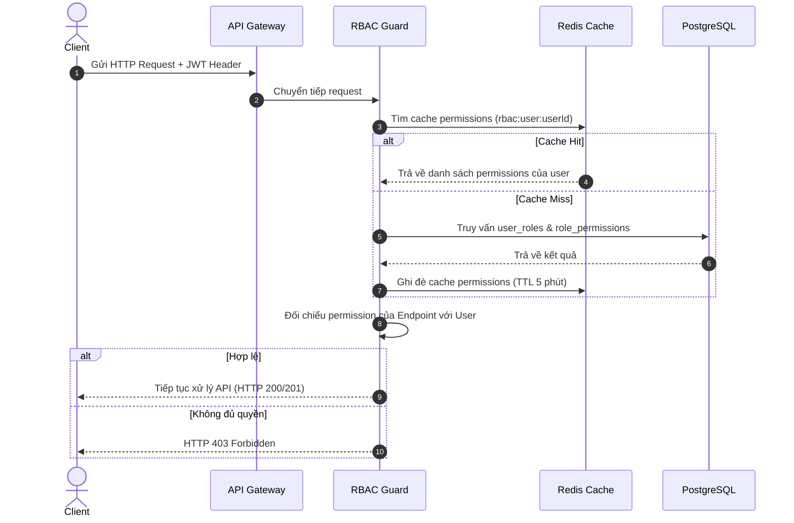

# Đặc tả: Kiểm Soát Truy Cập RBAC

## Mô tả
Hệ thống sử dụng ma trận vai trò - quyền hạn (RBAC) để giới hạn quyền truy cập tài nguyên của Khán giả, Ban tổ chức, Nhân viên soát vé và Admin hệ thống. Xác thực thông qua JWT token kết hợp lưu cache quyền hạn trên Redis.

## Luồng chính

## Kịch bản lỗi

### ES-01: Token hết hạn hoặc sai chữ ký
- **Điều kiện**: Client gửi JWT Token bị sửa đổi hoặc đã quá thời hạn `exp`.
- **Xử lý**: API Gateway/JWT Guard chặn ngay lập tức, trả về `401 Unauthorized`.

### ES-02: Quyền hạn của user thay đổi trong phiên làm việc
- **Điều kiện**: Admin thu hồi quyền của một Organizer đang đăng nhập.
- **Xử lý**:
  1. Server tăng `permission_version` của user trong PostgreSQL và xóa key cache `rbac:user:userId` tương ứng trên Redis.
  2. Request tiếp theo của user gửi lên có `permission_version` cũ (trong token) lệch với DB.
  3. RBAC Guard phát hiện lệch version, từ chối request và yêu cầu client refresh token hoặc đăng nhập lại.

## Ràng buộc
- **Bảo mật**: Không bao giờ nhét toàn bộ danh sách permissions vào JWT token (làm phình kích thước token và lỗi stale permissions). Chỉ nhét `sub`, `roles`, và `permission_version`.
- **Hiệu năng**: Bắt buộc phải cache permissions trên Redis để tránh truy vấn join 4 bảng database của PostgreSQL ở mỗi request.

## Tiêu chí chấp nhận
- Gán/hủy role của user phản ánh hiệu lực ngay lập tức trong vòng tối đa 1 giây nhờ cơ chế invalidate cache theo `permission_version`.
- Mọi API Endpoint thuộc nhóm Admin/Organizer/Staff đều phải được bảo vệ bằng `@UseGuards(JwtAuthGuard, RbacGuard)`.
