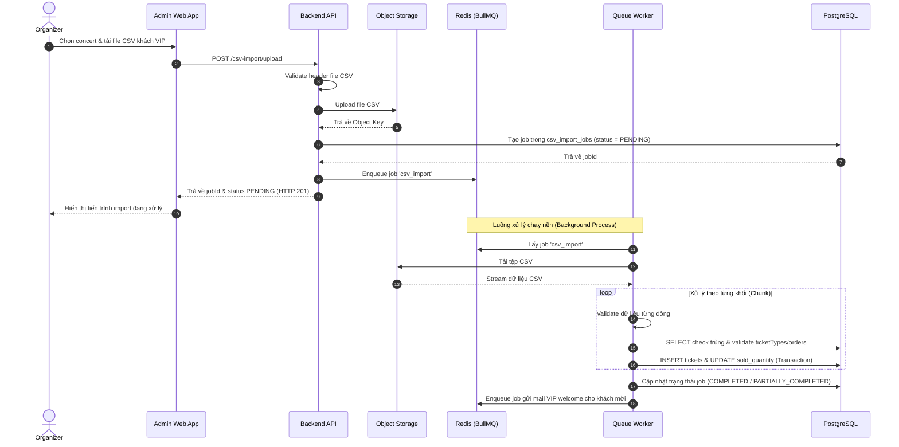

# Đặc tả: Import Danh Sách Khách VIP

## Mô tả
Cho phép Ban tổ chức (Organizer) tải lên tệp tin CSV chứa danh sách khách VIP từ đối tác tài trợ, hệ thống thực hiện phân tích và sinh vé VIP tự động chạy nền thông qua BullMQ, hỗ trợ ghi nhận lỗi chi tiết theo từng dòng và chạy lại idempotent.

## Luồng chính

1. Organizer chọn concert và tải lên file CSV từ Admin Web App.
2. Backend API nhận file, thực hiện validate định dạng cột (Header). Nếu hợp lệ, lưu file vào Object Storage (Supabase Storage/S3).
3. Backend tạo bản ghi `csv_import_jobs` với `status = PENDING`.
4. Enqueue job vào BullMQ và phản hồi ngay `jobId` cho Admin Web App (HTTP 201).
5. Queue Worker nhận job, thực hiện tải file từ Object Storage và đọc file theo dạng luồng (Stream) chia thành từng khối (Chunk).
6. Validate dữ liệu từng dòng (tên, email, số điện thoại, hạng vé).
7. Ghi nhận dữ liệu hợp lệ vào database, phát hành vé điện tử (e-ticket) và tự động cập nhật số lượng vé đã bán trong `ticket_types`.
8. Sau khi hoàn thành, cập nhật trạng thái job thành `COMPLETED` (hoặc `PARTIALLY_COMPLETED` nếu có dòng lỗi).

## Kịch bản lỗi

### ES-01: File CSV có dữ liệu không hợp lệ ở một số dòng (Partial Success)
- **Điều kiện**: File CSV có 1000 dòng, trong đó có 5 dòng bị sai định dạng email, 2 dòng bị thiếu số điện thoại.
- **Xử lý**: 
  1. Worker không rollback toàn bộ file. Nó bỏ qua các dòng lỗi, tiếp tục xử lý các dòng hợp lệ khác.
  2. Ghi nhận chi tiết lỗi của các dòng hỏng (số dòng, nội dung sai, lý do) vào báo cáo lỗi.
  3. Cập nhật job status thành `PARTIALLY_COMPLETED` để báo cho Organizer tải báo cáo lỗi về sửa.

### ES-02: Import lại file CSV đã sửa lỗi (Idempotent Retry)
- **Điều kiện**: Organizer sửa các dòng lỗi trong file CSV cũ và thực hiện import lại.
- **Xử lý**: 
  1. Server so sánh thông tin email/sđt của dòng mới với dữ liệu đã có trong PostgreSQL.
  2. Áp dụng ràng buộc `UNIQUE(concert_id, email)` để bỏ qua (skip) các dòng khách VIP đã được import thành công trước đó, tránh tạo vé trùng lặp.

## Ràng buộc
- **Memory Limit**: Bắt buộc đọc file CSV theo cơ chế chunk/stream, không được nạp toàn bộ file vào RAM để tránh làm tràn bộ nhớ của server khi file lớn.
- **Deduplication**: Kiểm soát trùng lặp scoped theo từng concert (`concert_id`).

## Tiêu chí chấp nhận
- Upload file sai định dạng (ví dụ XLS, PDF) hoặc thiếu cột bắt buộc bị hệ thống từ chối ngay lập tức tại Controller.
- Organizer có thể theo dõi tiến độ xử lý (% hoàn thành) và số dòng lỗi trực quan trên Admin Web App.
