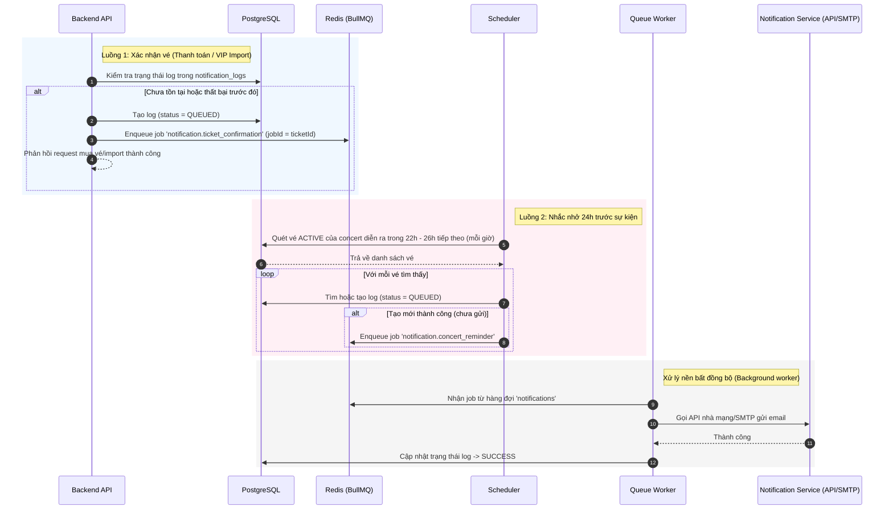

# Đặc tả: Thông Báo và Nhắc Nhở

## Mô tả
Gửi email thông báo xác nhận mua vé (kèm mã QR), thư chào mừng khách VIP, và lập lịch gửi email nhắc nhở trước sự kiện 24 giờ cho khán giả. Toàn bộ quy trình gửi thông báo chạy nền qua BullMQ, đảm bảo tính idempotent và có thể quan sát, gửi lại khi gặp lỗi.

## Luồng chính

### Luồng 1: Gửi thông báo xác nhận vé sau thanh toán / VIP Import
1. Khi thanh toán thành công hoặc import VIP thành công, Backend gọi `NotificationsService` để đưa thông báo vào hàng đợi (ví dụ: `notification.ticket_confirmation` hoặc `notification.vip_welcome`).
2. Hệ thống kiểm tra trong database `notification_logs` xem thông báo này đã được lên lịch hay gửi chưa. Nếu chưa hoặc đã lỗi trước đó, tạo bản ghi log với trạng thái `QUEUED`.
3. Đẩy job vào BullMQ queue `notifications` với tùy chọn retry lũy thừa (backoff exponential 5 giây, tối đa 3 lần) và đặt `jobId` duy nhất dạng `notification.ticket_confirmation:${ticketId}` để chống trùng.
4. Queue Worker nhận job từ queue, gọi `NotificationPort` (SMTP / SendGrid Adapter) để tiến hành gửi mail thật chứa thông tin vé và mã QR.
5. Sau khi gửi email thành công, Worker cập nhật trạng thái log trong `notification_logs` thành `SUCCESS`.

### Luồng 2: Lập lịch gửi nhắc nhở 24h trước concert
1. Một Scheduler chạy định kỳ mỗi giờ (`@Cron(CronExpression.EVERY_HOUR)`).
2. Scheduler quét database PostgreSQL tìm tất cả các vé (`status = 'ACTIVE'`) thuộc về concert sẽ bắt đầu trong khoảng từ 22 giờ đến 26 giờ tiếp theo.
3. Với mỗi vé thỏa mãn, Scheduler gọi `NotificationsService.queueConcertReminder`.
4. `queueConcertReminder` kiểm tra xem vé đó đã được gửi nhắc nhở chưa thông qua bảng `notification_logs`. Nếu chưa, tạo log trạng thái `QUEUED` và push job `notification.concert_reminder` vào BullMQ với `jobId` duy nhất là `notification.concert_reminder:${ticketId}`.
5. Worker nhận job, gửi email nhắc nhở chứa thông tin chi tiết sự kiện (thời gian, địa điểm, hạng vé) và cập nhật trạng thái log thành `SUCCESS`.

## Kịch bản lỗi

### ES-01: Gửi email thất bại do API bên thứ 3 lỗi
- **Điều kiện**: Nhà cung cấp dịch vụ email (SendGrid/SMTP) bị sập hoặc trả về timeout.
- **Xử lý**: BullMQ tự động retry tối đa 3 lần với exponential backoff. Ở lần thử cuối nếu vẫn lỗi, worker cập nhật trạng thái log thành `FAILED` và ghi nhận chi tiết lỗi vào database để Admin/Support theo dõi và trigger gửi lại thủ công qua Admin Web App.

### ES-02: Địa chỉ email không tồn tại (Bounce)
- **Điều kiện**: Email gửi đi bị bounce từ mail server đích.
- **Xử lý**: Webhook của email service thông báo bounce về server. Backend cập nhật log gửi thư thành thất bại và đánh dấu đơn hàng cần hỗ trợ để nhân viên liên hệ khách hàng cập nhật email đúng.

### ES-03: Tránh gửi trùng thông báo (Idempotent Delivery)
- **Điều kiện**: Sự kiện thanh toán thành công hoặc Scheduler được kích hoạt trùng lặp do lỗi mạng/hạ tầng.
- **Xử lý**: Ràng buộc unique hoặc check-exist trên `notification_logs` kết hợp cấu hình `jobId` cố định trong BullMQ ngăn việc tạo job lặp hoặc gửi email 2 lần cho cùng một vé.

## Ràng buộc
- **Xử lý bất đồng bộ (Asynchronous)**: Không thực hiện gửi email đồng bộ trực tiếp trong luồng request HTTP thanh toán/import. Bắt buộc xử lý qua BullMQ queue.
- **Idempotency**: Đảm bảo không gửi trùng lặp email xác nhận vé hoặc email nhắc nhở cho cùng một ticket.
- **Giám sát (Observability)**: Lưu trữ lịch sử tất cả các lượt gửi trong `notification_logs` kèm trạng thái (`QUEUED`, `SUCCESS`, `FAILED`) và lý do lỗi để Admin có thể theo dõi và retry thủ công.

## Tiêu chí chấp nhận
- Người dùng nhận được e-ticket QR trong vòng vài giây sau khi thanh toán thành công.
- Job bị lỗi được giữ lại trong hàng đợi để có thể kiểm tra và retry thủ công bởi Admin.
- Không có khách hàng nào nhận được email nhắc nhở trùng lặp.
