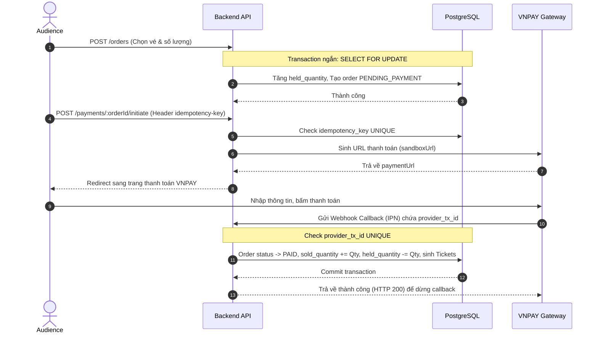

# Đặc tả: Luồng Thanh Toán và Chống Trùng

## Mô tả
Cho phép khán giả thanh toán đơn hàng đang giữ chỗ thông qua cổng thanh toán VNPAY sandbox, xử lý callback thanh toán idempotent, và chống double charge.

## Luồng chính

## Kịch bản lỗi

### ES-01: Nhấn thanh toán nhiều lần (Double Submit)
- **Điều kiện**: Audience click nút thanh toán liên tục khiến client gửi nhiều request `POST /payments/:orderId/initiate`.
- **Xử lý**: Lệnh gọi thứ hai có cùng `idempotency-key` sẽ bị chặn bởi ràng buộc `UNIQUE` trong DB. Backend API trả về ngay URL thanh toán đã tạo trước đó mà không trừ tiền lần 2.

### ES-02: Callback từ Gateway gửi trùng (Double Callback)
- **Điều kiện**: VNPAY gửi callback xác nhận thanh toán nhiều lần do lỗi mạng hoặc cơ chế retry.
- **Xử lý**: 
  1. Backend API kiểm tra mã giao dịch `provider_tx_id` trong DB.
  2. Nếu transaction status đã là `CONFIRMED`, server bỏ qua việc cập nhật vé/email, ghi log audit và trả về HTTP 200 lập tức cho VNPAY.

### ES-03: Gateway thanh toán bị lỗi (Timeout)
- **Điều kiện**: API của VNPAY bị sập hoặc quá tải, không phản hồi trong 10 giây.
- **Xử lý**: Circuit Breaker chuyển sang trạng thái `OPEN`. Các request thanh toán mới lập tức nhận lỗi `503 Service Unavailable`. Người dùng không bị trừ tiền oan.

## Ràng buộc
- **Database Transaction**: Không bao giờ được gọi API VNPAY khi database transaction tạo order đang mở (tránh giữ connection pool quá lâu gây sập DB).
- **Idempotency Key**: Bắt buộc phải có độ duy nhất cao và lưu trữ lâu dài trong PostgreSQL (không dùng Redis lưu trữ tạm thời cho trạng thái thanh toán).

## Tiêu chí chấp nhận
- Đảm bảo không xảy ra bất kỳ trường hợp bán vượt vé (Oversell) nào nhờ check constraint ở DB.
- Các callback trùng lặp 100% không tạo ra vé trùng hoặc gửi email xác nhận lần 2.
