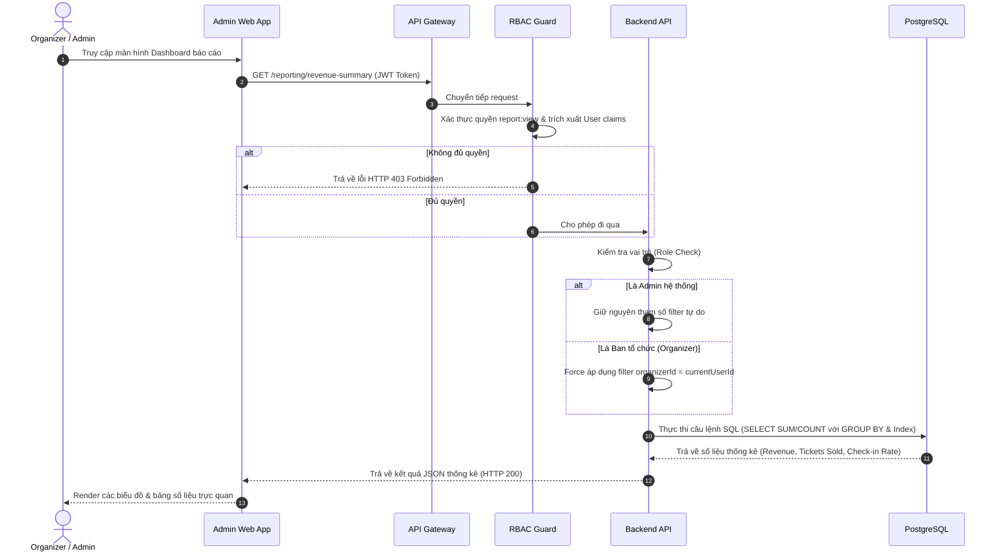

# Đặc tả: Báo Cáo Doanh Thu và Soát Vé

## Mô tả
Cung cấp các số liệu và biểu đồ thống kê thời gian thực cho Ban tổ chức (Organizer) và Admin hệ thống bao gồm: tổng doanh thu, số vé đã bán, phân rã trạng thái đơn hàng, tỷ lệ check-in soát vé, hỗ trợ phân quyền truy cập theo vai trò và phạm vi sở hữu sự kiện (Organizer Scope).

## Luồng chính

1. Người dùng (Ban tổ chức hoặc Admin hệ thống) truy cập màn hình báo cáo trên `Admin Web App`.
2. Frontend gửi request đến các API báo cáo (ví dụ: `GET /reporting/revenue-summary`, `GET /reporting/checkin-rate`,...) kèm theo JWT Token trong header.
3. API Gateway / RBAC Guard xác thực quyền `report:view` của người dùng.
4. Backend API thực hiện kiểm tra vai trò của người dùng:
   - Nếu là **Admin hệ thống**, cho phép truy vấn toàn bộ dữ liệu hoặc lọc theo bất kỳ concert/organizer nào.
   - Nếu là **Ban tổ chức (Organizer)**, Backend bắt buộc áp dụng bộ lọc theo ID của Organizer đăng nhập (`organizerId = currentUserId`), chỉ cho phép truy vấn dữ liệu của các concert do chính Organizer đó tạo ra.
5. Reporting Repository thực thi các câu truy vấn SQL tối ưu trên PostgreSQL (sử dụng index trên `orders.createdAt`, `checkin_logs.scanned_at`) để tính toán số liệu thống kê:
   - **Doanh thu (Revenue Summary & Timeline)**: Tính tổng `total_amount` từ các đơn hàng có trạng thái `PAID` theo thời gian hoặc theo concert.
   - **Số vé đã bán (Tickets Sold & Timeline)**: Thống kê số lượng vé đã phát hành thành công của từng hạng vé.
   - **Trạng thái đơn hàng (Order Status Breakdown)**: Phân rã số lượng và tỷ lệ đơn hàng theo trạng thái (`PAID`, `PENDING_PAYMENT`, `EXPIRED`, `CANCELLED`).
   - **Tỷ lệ check-in (Check-in Rate & Timeline)**: Thống kê số lượng vé đã quét hợp lệ (`status = ACCEPTED`) so với tổng số vé bán ra.
6. Backend phản hồi dữ liệu thống kê dạng cấu trúc JSON về cho Admin Web App để hiển thị các biểu đồ (line chart, pie chart) và bảng số liệu trực quan.

## Kịch bản lỗi

### ES-01: Truy cập trái phép dữ liệu của Organizer khác (Cross-Organizer Access)
- **Điều kiện**: Một Organizer cố tình gọi API báo cáo kèm theo ID concert hoặc ID organizer khác để truy cập thông tin không thuộc quyền quản lý của mình.
- **Xử lý**: Backend API thực hiện kiểm tra quyền sở hữu (ownership check) trong database. Nếu concert yêu cầu không thuộc về Organizer đang đăng nhập, hệ thống lập tức từ chối và trả về lỗi `403 Forbidden`.

### ES-02: Cơ sở dữ liệu quá tải khi truy vấn lượng dữ liệu lớn
- **Điều kiện**: Người dùng chọn khoảng thời gian truy vấn quá rộng (không giới hạn) gây tải lớn cho database.
- **Xử lý**: Hệ thống giới hạn khoảng thời gian truy vấn mặc định hoặc tối đa (ví dụ: tối đa 1 năm) và áp dụng các index composite phù hợp trên PostgreSQL để tối ưu hóa tốc độ truy vấn, tránh Full Table Scan.

## Ràng buộc
- **Tính nhất quán dữ liệu**: Số liệu báo cáo doanh thu và số vé bán ra phải là dữ liệu thời gian thực được tính toán trực tiếp từ các bảng giao dịch (`orders`, `payments`, `tickets`) trong PostgreSQL để đảm bảo tính chính xác tuyệt đối phục vụ đối soát tài chính (không dùng cache Redis cho báo cáo doanh thu).
- **Phân quyền và Phạm vi (Scope)**: Đảm bảo Organizer chỉ được phép truy xuất dữ liệu báo cáo của các concert thuộc quyền sở hữu của mình.

## Tiêu chí chấp nhận
- Báo cáo phản hồi nhanh chóng (dưới 1 giây) khi truy vấn trên tập dữ liệu lớn nhờ tối ưu index.
- Ngăn chặn hoàn toàn việc xem chéo dữ liệu báo cáo giữa các Organizer khác nhau.
- Số liệu vé đã check-in thành công và các trường hợp xung đột (conflict) phải hiển thị rõ ràng để Ban tổ chức đối soát.
