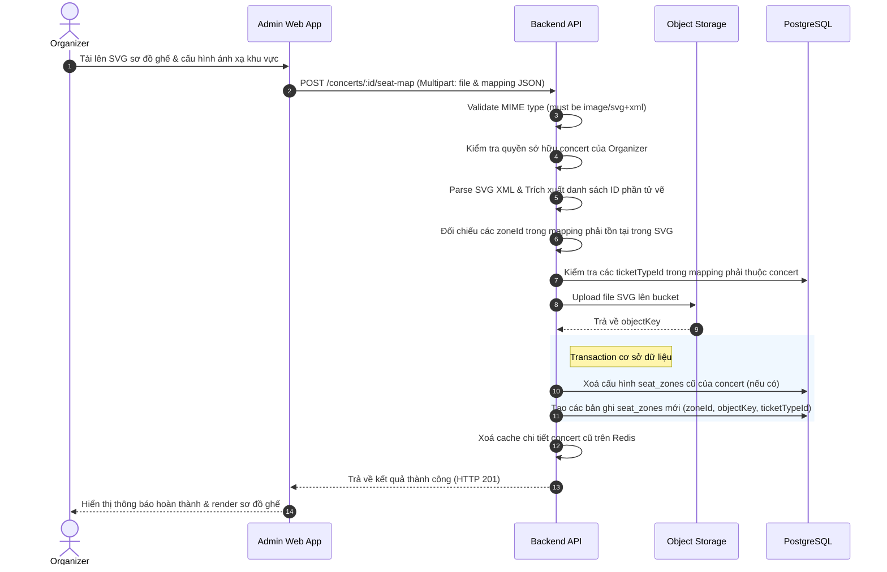

# Đặc tả: Sơ Đồ Ghế SVG và Ánh Xạ Khu Vực

## Mô tả
Cho phép Ban tổ chức (Organizer) tải lên tệp sơ đồ ghế dạng ảnh vector SVG, trích xuất danh sách các ID phần tử vẽ trong tệp SVG để kiểm tra và ánh xạ chúng sang các hạng vé (ticket types) tương ứng của concert. Sơ đồ ghế sau khi ánh xạ sẽ được lưu trữ và trả về URL được ký tạm thời (presigned URL) để hiển thị sơ đồ tương tác ở Audience Web.

## Luồng chính

1. Ban tổ chức chọn concert và tải lên file sơ đồ ghế SVG kèm theo cấu hình ánh xạ (mapping dạng JSON kết nối từ `zoneId` trong SVG sang `ticketTypeId` trong hệ thống) trên Admin Web App.
2. Backend API nhận file, validate định dạng MIME type bắt buộc là `image/svg+xml`.
3. Backend kiểm tra quyền cập nhật/sở hữu concert của Organizer (RBAC).
4. Backend parse nội dung SVG bằng thư viện XML parser để kiểm tra tính hợp lệ và trích xuất tất cả các ID phần tử vẽ (thuộc tính `id` trong các thẻ XML).
5. Backend đối chiếu cấu hình ánh xạ:
   - Tất cả các `zoneId` cấu hình bắt buộc phải tồn tại dưới dạng ID trong file SVG.
   - Các `ticketTypeId` cấu hình bắt buộc phải thuộc danh sách hạng vé hợp lệ của concert đó.
6. Backend upload file SVG lên Object Storage (S3 / MinIO) với đường dẫn động (ví dụ: `concerts/{concertId}/seatmap_{timestamp}.svg`).
7. Backend thực hiện transaction:
   - Xóa các ánh xạ khu vực cũ của concert trong bảng `seat_zones` (nếu có).
   - Thêm các bản ghi khu vực mới nối `concertId`, tên khu vực (`zoneId`), đường dẫn tệp SVG và `ticketTypeId`.
8. Backend xóa cache chi tiết concert cũ để cập nhật sơ đồ ghế mới nhất cho người dùng.

## Kịch bản lỗi

### ES-01: File tải lên không đúng định dạng SVG hoặc bị lỗi cú pháp
- **Điều kiện**: File tải lên không phải MIME type `image/svg+xml` hoặc file SVG bị lỗi cú pháp XML.
- **Xử lý**: Hệ thống dừng xử lý ngay lập tức tại Service và trả về lỗi `400 Bad Request` chi tiết (ví dụ: *"Invalid SVG file format"*), không lưu file và không ghi nhận ánh xạ.

### ES-02: Zone ID trong mapping cấu hình không khớp với SVG
- **Điều kiện**: Organizer cấu hình ánh xạ một khu vực có ID `vip-zone-01` nhưng trong file SVG tải lên không có thẻ nào chứa thuộc tính `id="vip-zone-01"`.
- **Xử lý**: Hệ thống trả về lỗi `400 Bad Request` thông báo rõ: *"Zone 'vip-zone-01' not found in SVG"* để Organizer sửa lại file SVG hoặc cấu hình mapping.

### ES-03: Ánh xạ vào hạng vé không tồn tại hoặc sai concert
- **Điều kiện**: Cấu hình `ticketTypeId` gửi lên không tồn tại hoặc thuộc về một concert khác.
- **Xử lý**: Hệ thống trả về lỗi `400 Bad Request` chi tiết (ví dụ: *"Ticket Type '...' does not belong to this concert"*) để chặn lưu trữ dữ liệu không nhất quán.

## Ràng buộc
- **Định dạng file**: Chỉ chấp nhận tệp vector SVG hợp lệ để có thể render tương tác (cho phép người dùng click chọn khu vực để mua vé trên Frontend).
- **Tính nhất quán**: Mọi hạng vé được ánh xạ bắt buộc phải thuộc cùng một concert.

## Tiêu chí chấp nhận
- Upload sơ đồ ghế thành công tự động cập nhật hiển thị sơ đồ ghế tương tác dạng SVG trên trang đặt vé của Khán giả.
- Hỗ trợ trả về đường dẫn đã ký (presigned URL) với thời gian hết hạn nhất định để bảo mật tệp sơ đồ ghế.
